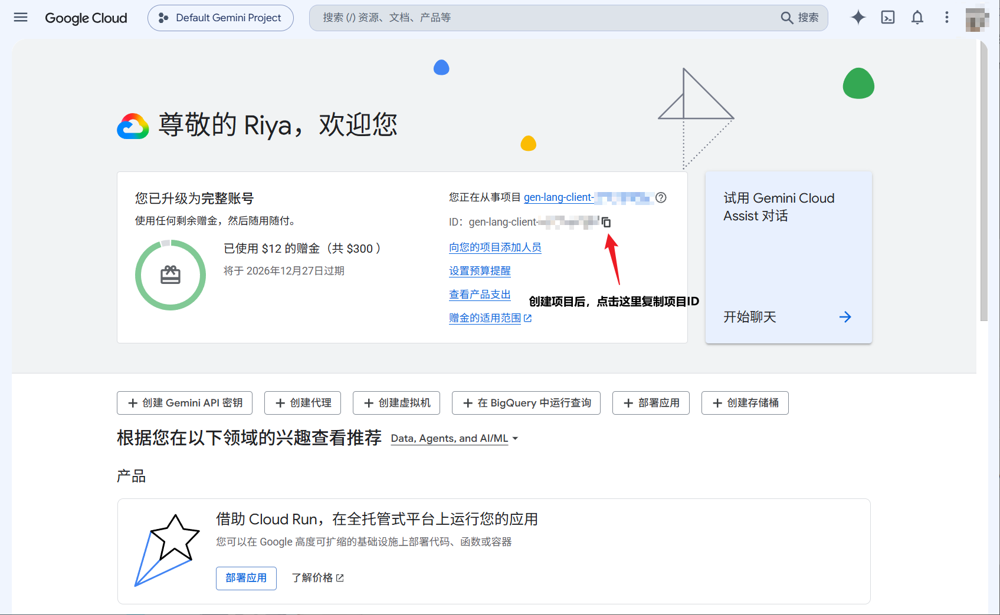
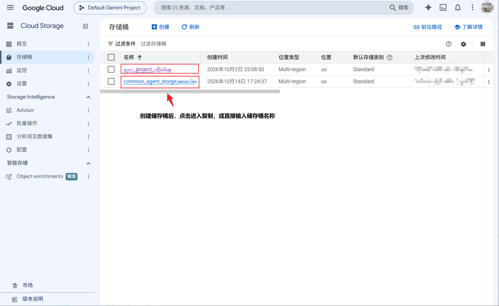
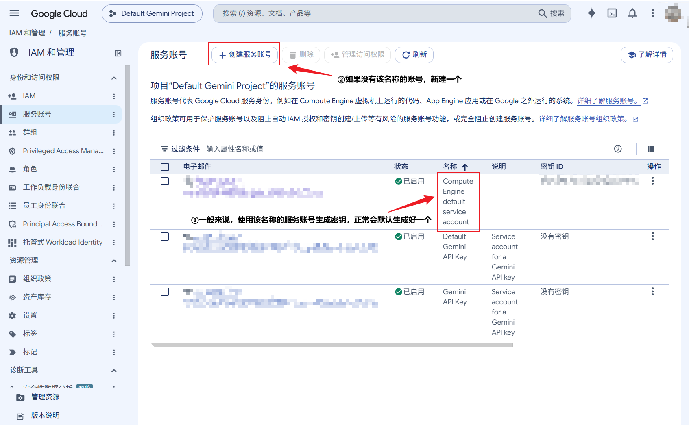
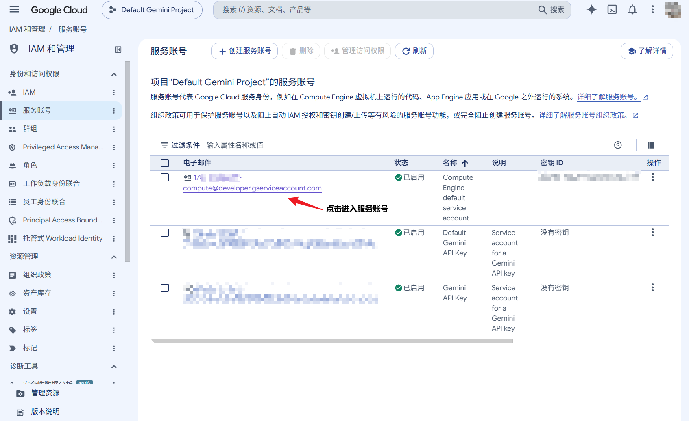
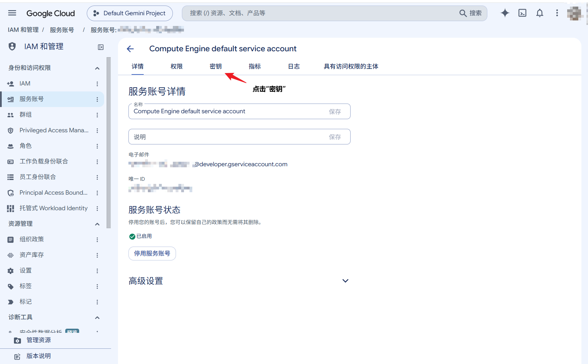
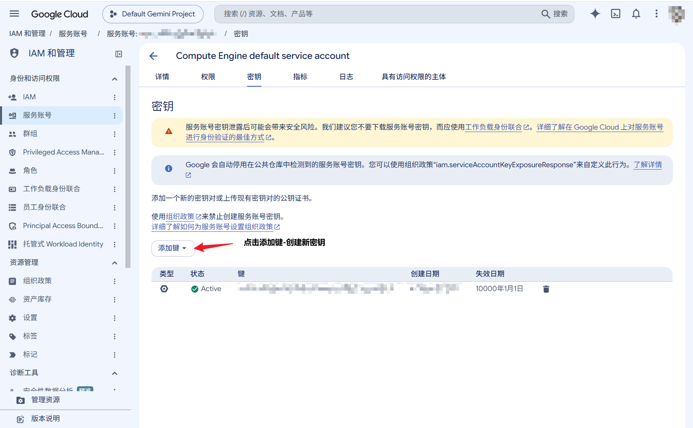
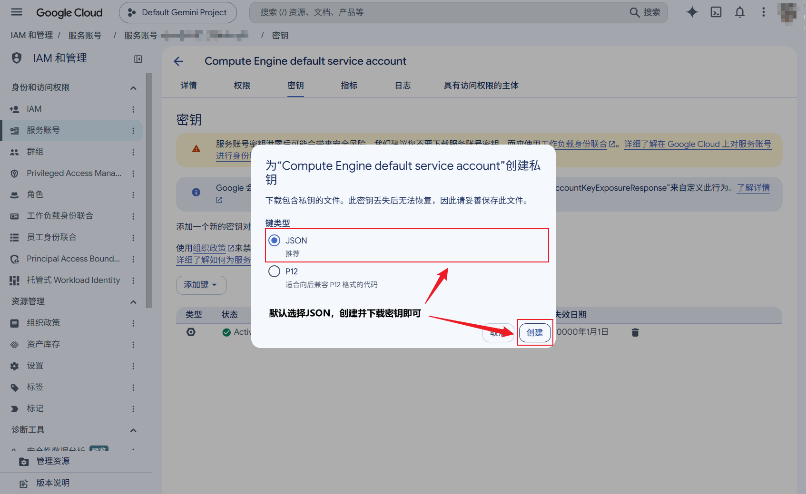

# Vertex Batch Studio

[简体中文](README.md) | **English**

A Windows desktop workspace for **Google Cloud Vertex AI Batch**, combining **batch image generation** and a **Harness local agent** in a single application.

[Download Installer](https://github.com/veluRiya000/Vertex-Batch-Studio/releases/tag/v0.3.1) · [Feature Source](https://github.com/veluRiya000/Vertex-Batch-Studio/tree/feature/harness-batch) · [Report an Issue](https://github.com/veluRiya000/Vertex-Batch-Studio/issues)

> **New here? [Open the illustrated Google Cloud setup guide: Project ID, storage bucket, and JSON key](#google-cloud-setup-guide)**

> **Release Notes (`v0.3.1`)**
> A single installer (~**69.5 MB**) bundles batch image generation, Harness, the Python backend, and the Node.js runtime out of the box—no separate runtime installation required. Source code for the current feature set is on the `feature/harness-batch` branch.

---

## Two Modes

Switch modes anytime from the top-left corner (Image Generation uses a blue theme; Harness uses a warm theme). Switching views does not interrupt background jobs.

| Mode | Best For | Execution Flow |
| --- | --- | --- |
| **Image Generation** | Generating image batches, reusing character/style references, and organizing outputs | Queue multiple tasks and submit the batch manually |
| **Harness Agent** | Processing local files, writing docs, editing code, and running commands | Start a task to run an automated `Model → Tools → Model` loop |

> **About Harness**: Built on the session, tool, and approval mechanisms of [DeepSeek Harness](https://github.com/deepseek-ai/deepseek-harness), with all model inference routed through Google Cloud Batch. No DeepSeek API key is required.

---

## Key Features

### 1. Batch Image Generation

- **Models & Generation Parameters**: Dedicated image model catalog with configurable aspect ratio, resolution, image count (1–4 per task), and model-specific parameters.
- **Multi-Image Tasks & Asset Reuse**: Requesting multiple images in a single task submits independent generation requests within the same cloud Batch job and groups the results into one conversation entry. Prompts, parameters, and GCS reference URLs are automatically reused across the batch without redundant uploads.
- **Shared Reference Library**: Organize references by style, character, or scene. Switch between list and grid views, drag to reorder, preview full-size images, and add assets directly to your active prompt.
- **Project & Result Management**: Create, rename, duplicate, retry, archive, and delete projects (supports collapsible long prompts and automatic draft preservation). Track batch progress, preview returned images, customize output directories, and retain raw payloads for re-downloading or re-decoding.
- **Flexible Layout**: Freely resize the sidebar and reference library, or collapse the project list and generation queue.

> **Note**: The selected image count controls the number of cloud requests submitted, not a guaranteed number of returned images. Content filtering or failed requests may result in fewer images (if a single request returns multiple images, all are saved). Failed requests are never automatically resubmitted at extra cost.

### 2. Harness Agent

- **Workspaces & Persistent Sessions**: Bind a local workspace directory and retain conversation context, attachments, tool outputs, and file change history.
- **File & Shell Tools**: Read, search, create, and edit local files, execute PowerShell commands, and inspect deliverables.
- **Permissions & Safety Approvals**: Leverages DSH permission modes, the Windows sandbox, and user approvals for out-of-scope actions. Built-in file version checks prevent overwriting files modified externally.
- **Attachments & Text Preloading**: Drag and drop images and text files into the composer. Size-limited text attachments are preloaded automatically to save extra Batch rounds spent reading uploaded files (video inputs are currently unsupported and skipped).
- **Custom Persona & Extensions**: Customize the role prompt in Settings, and manually configure Skills and MCP servers (external MCP services are not connected by default).
- **Batch Activity & Local Limits**: Monitor execution steps, queue time, active jobs, token usage, estimated costs, and reserved amounts. Optional local limits allow setting budgets, request caps, and custom output allowances (disabled by default).

**Built-in Harness Models:**

| Display Name | API Model ID |
| --- | --- |
| Gemini 4 Argon | `gemini-4-argon` |
| Gemini 3.8 Flash | `gemini-3.8-flash` |
| Gemini 3.1 Pro Preview | `gemini-3.1-pro-preview` |

*Note: Actual availability depends on Google Cloud model support, project permissions, and region. Harness and Image Generation maintain separate model selections.*

### 3. Desktop Experience & Notifications

- **Desktop Integration**: Light/dark themes, English/Chinese UI, system tray support, launch at login, and start minimized.
- **Native Windows Notifications (Enabled by Default)**: Image and Harness queues are tracked independently. Get notified after each batch or when all queued tasks of the same type finish, with optional failure alerts.
- **Custom Notification Sounds**: Includes 3 built-in alert sounds (with preview) plus support for importing custom WAV or MP3 files.
- **Shared Cloud Configuration**: Both modes share the same Google Cloud connection settings, complete with quick-launch console links next to the Project, Bucket, and Credential fields.

---

## Getting Started

### 1. Download & Install

1. Visit the [0.3.1 Release page](https://github.com/veluRiya000/Vertex-Batch-Studio/releases/tag/v0.3.1) and download `VertexBatchStudio-Setup-0.3.1-x64.exe`.
2. Close any running older version of the app, then run the installer.
3. Launch the application, configure Google Cloud, and select a mode.

*System Requirements: Windows x64. No separate Python, Node.js, or Rust installation is needed. Uses system WebView2 (downloaded automatically during setup if missing). The installer is currently unsigned; SHA-256 checksums are provided on the release page.*

### 2. Configure Google Cloud

Before running cloud models, complete the following one-time setup:

1. **Enable API**: Prepare a Google Cloud project with Billing and the **Vertex AI API** enabled, ensuring access to your target models.
2. **Create a Storage Bucket**: **Create a Cloud Storage bucket first** to store reference assets, Batch input payloads, and output results.
3. **Prepare Service Account Credentials**: Create a service account JSON key with Vertex AI Batch and Storage bucket permissions (ensure the Vertex AI Service Agent also has access to bucket objects).
4. **Connect in App**: Open **Settings → Google Cloud sign-in**, enter your Project ID and Bucket Name, import the JSON key file, and click **Check connection**.

---

## Google Cloud Setup Guide

The screenshots below use the Chinese Google Cloud console. The accompanying instructions name the corresponding English controls.

### Project ID: where to copy it

Open the Google Cloud console dashboard for your project and copy the value next to **ID** into the app's **Project ID** field. Use the project ID, rather than its display name or numeric project number.




### Storage bucket: where to find its name

Create or select a bucket under **Cloud Storage → Buckets**, then copy its name into the app's **Bucket** field. The highlighted rows show bucket names; use the actual name from your own project.




### Service account JSON key: how to create and download it

1. Open **IAM & Admin → Service Accounts** and choose a service account with the required permissions. If needed, click **Create service account**. The default service account shown in the screenshot is an example, not a requirement.

   

2. Click the target service account's email address to open its details.

   

3. Select the **Keys** tab.

   

4. Click **Add key → Create new key**.

   

5. Choose **JSON** and click **Create** to download the key file. In the app, open **Settings → Google Cloud sign-in → Import JSON key** and select the downloaded file. It does not need to be renamed to `key.json`. Keep the key file local; do not commit it to GitHub.

   


---

## Workflows

### Image Generation

```text
Create Project → Enter Prompt & References → Select Model & Settings → Add Task
                                                                          ↓
                                                            Submit Batch Manually
                                                                          ↓
                                                            Wait → Preview & Save
```

- **Batching Tasks**: Clicking **Add task** adds an entry to the current batch. A batch can hold multiple tasks, each expanding into the selected number of cloud requests upon submission (e.g., 2 tasks requesting 4 images each appear as 2 conversation items and submit 8 JSONL requests).
- **Frozen Inputs & Archiving**: Task inputs lock once upload begins; create a new batch to make edits or run another generation. Right-click a project to rename or archive it. Archived projects can be managed or deleted from **Settings → Archive**.

### Harness Agent

```text
Switch to Harness → Select Workspace → Add Task & Attachments → Choose Model & Permissions → Start
                                                                                               ↓
                                                                      Batch Result → Local Tools / Approval
                                                                                               ↓
                                                                          Next Round (if needed) → Delivery
```

- **Asynchronous Batch Execution**: All model calls run through Google Cloud Batch without falling back to real-time streaming APIs. Status indicators, tool logs, and file diffs update live, while model responses arrive once the active Batch job completes.
- **Prompting Tip**: Because dependent tool steps require sequential Batch rounds, state your goal, input files, target output path, and acceptance criteria upfront in a single prompt whenever possible.

---

## Data Storage & Recovery

The installed Windows app stores user data in a dedicated directory (retained by default upon uninstallation):

```text
%APPDATA%/VertexBatchStudio/
├── settings.json             # Appearance, desktop behavior, and notification settings
├── secrets/                  # Imported service account credentials
├── data/
│   ├── references/           # Shared reference image library
│   ├── batches/              # Image inputs, raw payloads, decoded images, and logs
│   ├── archive/              # Archived image projects
│   ├── harness/              # Sessions, attachments, ledger, and raw model responses
│   └── notifications/        # Custom alert sounds and notification history
└── .runtime/                 # Local runtime and connection state
```

- **Minimize to Tray**: Background polling and completion notifications continue running normally.
- **Exit or Shut Down**: Local tools and download monitors stop, while jobs already submitted to Google Cloud continue running remotely.
- **Restart Recovery**: On relaunch, Image Generation automatically resumes job polling, downloading, and decoding. Harness reconciles submitted requests, though seamless recovery of an interrupted multi-step agent turn is not guaranteed (avoid blindly re-running tasks with side effects).
- **Archiving & Deletion**: Archiving or deleting projects only removes local files and does not delete objects in Google Cloud Storage.

---

## Costs, Limits & Boundaries

- **Cost Estimates vs. Billing**: The UI separates **estimated usage costs** from **pre-submission reservations**. Reservations are local tracking estimates, not actual charges. Final charges, free trial credits, and discounts are determined by Google Cloud Billing.
- **Local Run Limits**: When enabled, local budgets and request caps only constrain subsequent submissions without altering jobs already in flight. Disabling local limits does not expand file/command permissions or bypass cloud quotas.
- **Long-Output Continuation (Argon)**: Argon attempts long-output continuation only when the cloud returns a valid continuation token. Missing tokens, quota limits, or errors stop generation while preserving raw results; million-token output is not guaranteed.
- **Safety & Sandbox Scope**: Truncated or malformed tool arguments are rejected before execution. The Windows sandbox primarily restricts file writes—it is not a full virtual machine and does not isolate file reads, networking, or processes (nor do external MCP servers inherit sandbox isolation).
- **Validation Status**: Basic offline and packaged startup flows have been verified, while broader cloud edge cases, failure recovery, and in-place upgrade paths remain under active testing.

---

## Build & Run from Source

### 1. Clone the Repository

```powershell
git clone --branch feature/harness-batch --recurse-submodules https://github.com/veluRiya000/Vertex-Batch-Studio.git
cd Vertex-Batch-Studio
```

> For an existing clone, run `git submodule update --init --recursive` to fetch the pinned DSH submodule (GitHub source ZIP downloads do not include submodules).

### 2. Environment & Dependencies

- **Python 3.12** (dependencies locked via `requirements.lock.txt`)
- **Node.js & npm** (the Harness component builder pins **Node.js 24.18.0**)
- **Rust toolchain**, Visual Studio C++ Build Tools, and Windows SDK (required for desktop compilation)

```powershell
python -m venv .venv
.\.venv\Scripts\python.exe -m pip install -r requirements.lock.txt
.\.venv\Scripts\python.exe -m pip install --no-deps -e .
Copy-Item .env.example .env
cd frontend
npm.cmd ci
cd ..
```

Configure cloud settings for source development in `.env` (`VERTEX_MODEL` sets the default image model):

```dotenv
GOOGLE_CLOUD_PROJECT=your-project-id
GCS_BUCKET=your-storage-bucket
GOOGLE_CLOUD_LOCATION=global
VERTEX_MODEL=gemini-3.1-flash-image
GOOGLE_APPLICATION_CREDENTIALS=secrets/service-account.json
VBS_DATA_DIR=data
VBS_POLL_SECONDS=30
```

### 3. Run in Development Mode

To run the image backend and web frontend in two terminals:

```powershell
# Terminal 1 (repository root)
.\.venv\Scripts\python.exe -m backend serve

# Terminal 2 (frontend directory)
npm.cmd run dev
```

For desktop development, run `npm.cmd run desktop` inside `frontend/`. Before using Harness from source, follow the [Harness Component Build Guide](https://github.com/veluRiya000/Vertex-Batch-Studio/blob/feature/harness-batch/docs/HARNESS_COMPONENT.md) to compile the pinned upstream and assemble `harness/component/`.

### 4. Build the Windows Installer

Once `harness/component/` is built, run from the repository root:

```powershell
powershell -ExecutionPolicy Bypass -File packaging/build-windows.ps1 -Python .venv/Scripts/python.exe
```

Installer artifacts are written to `release/`.

### 5. Project Structure & Tests

| Directory | Contents |
| --- | --- |
| `backend/` | FastAPI server, image batching, Harness Batch scheduler, cost tracking, and notifications |
| `frontend/src/` | Web UI, mode switching, and shared settings |
| `frontend/src-tauri/` | Tauri desktop windowing, tray integration, and native bridges |
| `harness/plugins/` | Batch model adapter, prompt policies, and Harness theme plugins |
| `harness/upstream/` | Pinned DSH upstream submodule |
| `packaging/` | Backend freezing and combined Windows installer scripts |
| `tests/`, `docs/` | Automated backend tests and technical documentation |

```powershell
# Run backend tests (from repository root, using temporary data and mock cloud)
.\.venv\Scripts\python.exe -m unittest discover -s tests -t . -v

# Run frontend tests and build (from frontend directory)
npm.cmd test
npm.cmd run build
```

The backend CLI also remains available via `python -m backend --help`.

---

## Documentation

- [Local API & Image Workflows](https://github.com/veluRiya000/Vertex-Batch-Studio/blob/feature/harness-batch/docs/API.md)
- [Harness Features & Permissions](https://github.com/veluRiya000/Vertex-Batch-Studio/blob/feature/harness-batch/docs/HARNESS_FEATURES.md)
- [Model Entries](https://github.com/veluRiya000/Vertex-Batch-Studio/blob/feature/harness-batch/docs/HARNESS_MODELS.md)
- [Long-Output Continuation](https://github.com/veluRiya000/Vertex-Batch-Studio/blob/feature/harness-batch/docs/HARNESS_CONTINUATION.md)
- [Completion Notifications](https://github.com/veluRiya000/Vertex-Batch-Studio/blob/feature/harness-batch/docs/COMPLETION_NOTIFICATIONS.md)
- [Windows Packaging](https://github.com/veluRiya000/Vertex-Batch-Studio/blob/feature/harness-batch/packaging/README.md)

*(Note: Some linked technical documents are currently available in Chinese only.)*

---

## Feedback & Licensing

- **Issues & PRs**: When reporting an issue, please include the app version, active mode, reproduction steps, and sanitized logs (**never upload service account keys, access tokens, or unredacted private sessions**). Pull requests should target the active development branch.
- **License**: This repository does not currently include a project-wide `LICENSE` file; usage and redistribution are subject to the maintainer's terms. The `harness/upstream` submodule is pinned to `d743267388641bc76f17c45ce8b4c231aed1d32c` under the MIT License (which does not automatically extend to the rest of this repository). Bundled runtime packages retain their respective third-party and Node.js license notices.
- **Disclaimer**: Google Cloud, Vertex AI, and Gemini are trademarks or products of their respective owners. This project is not affiliated with or endorsed by Google.