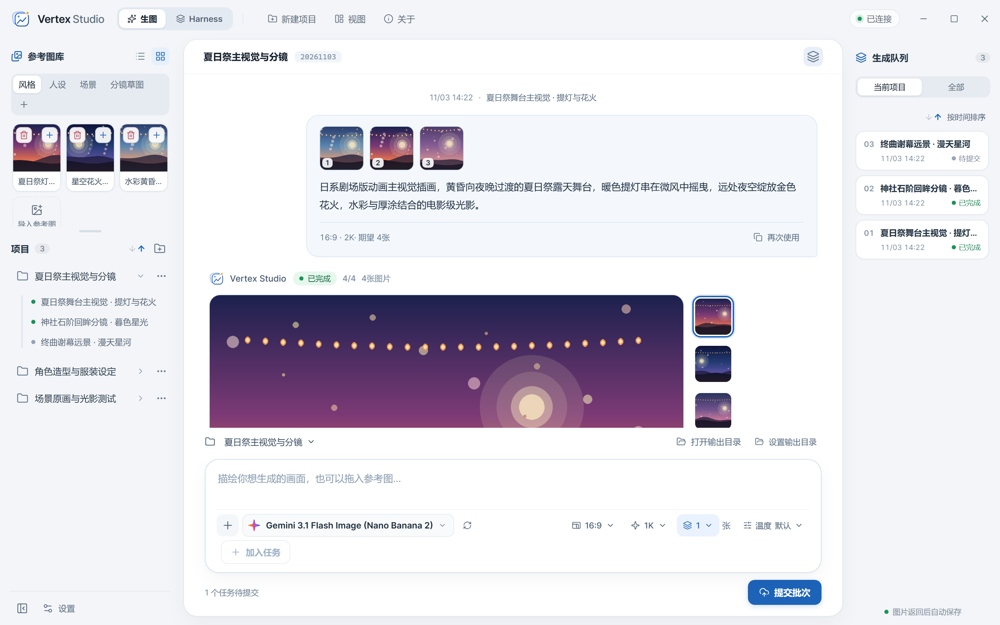
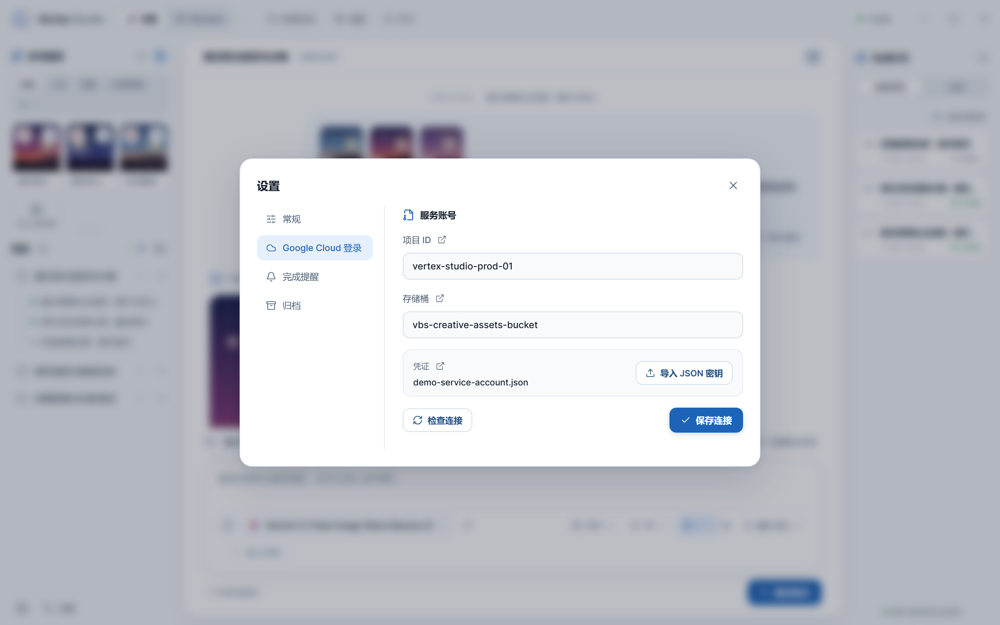
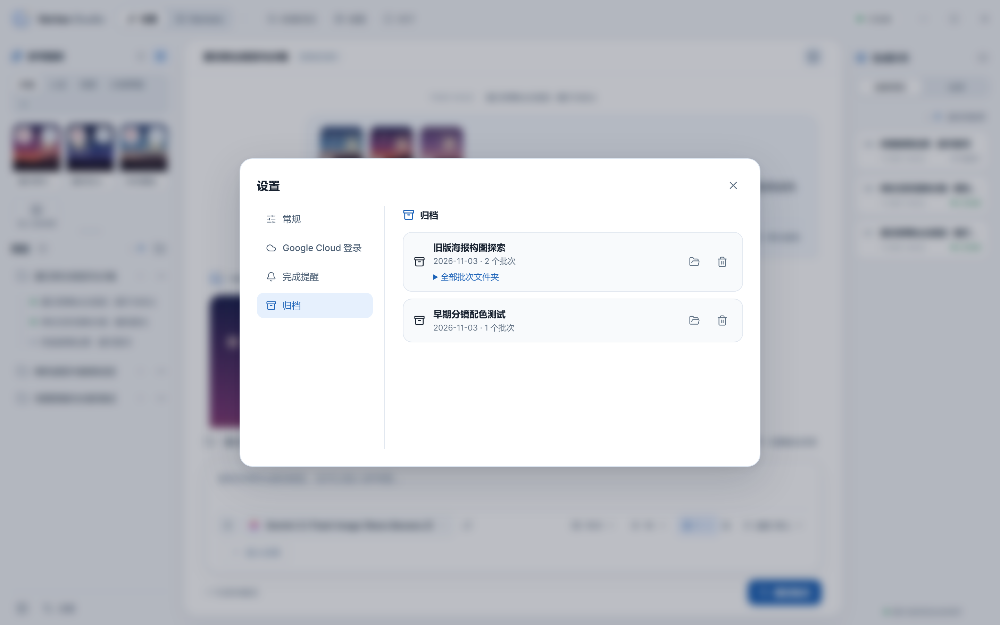
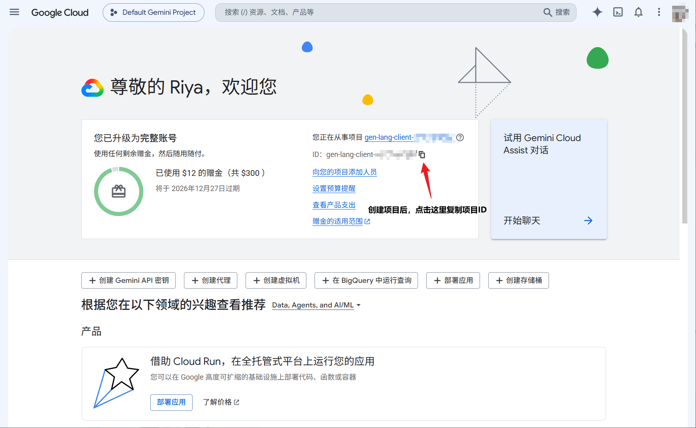
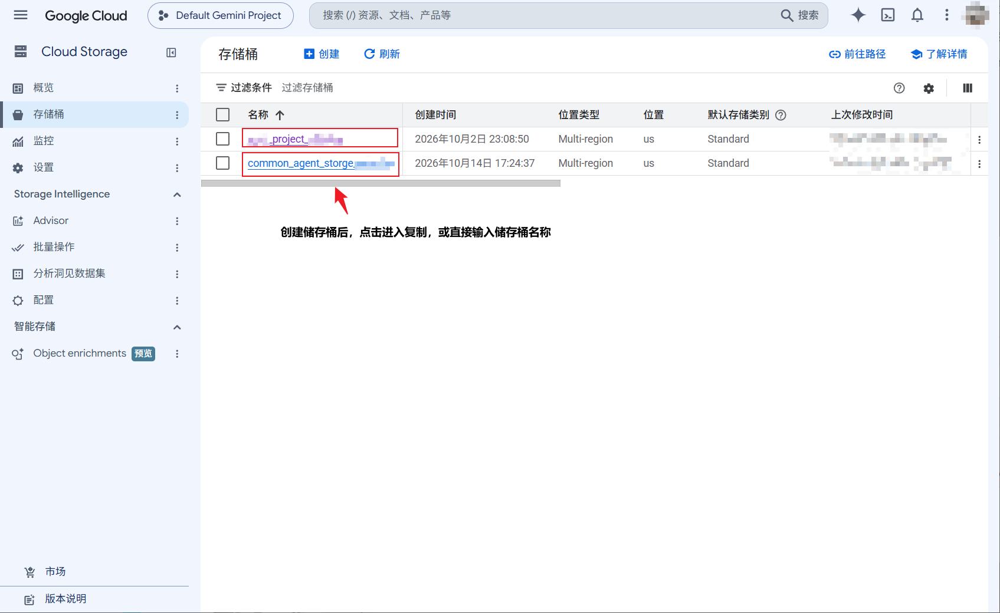
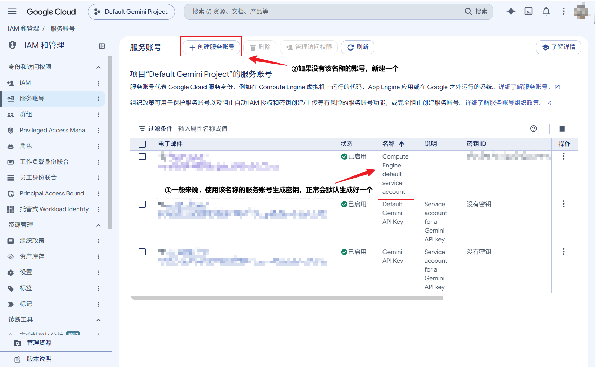
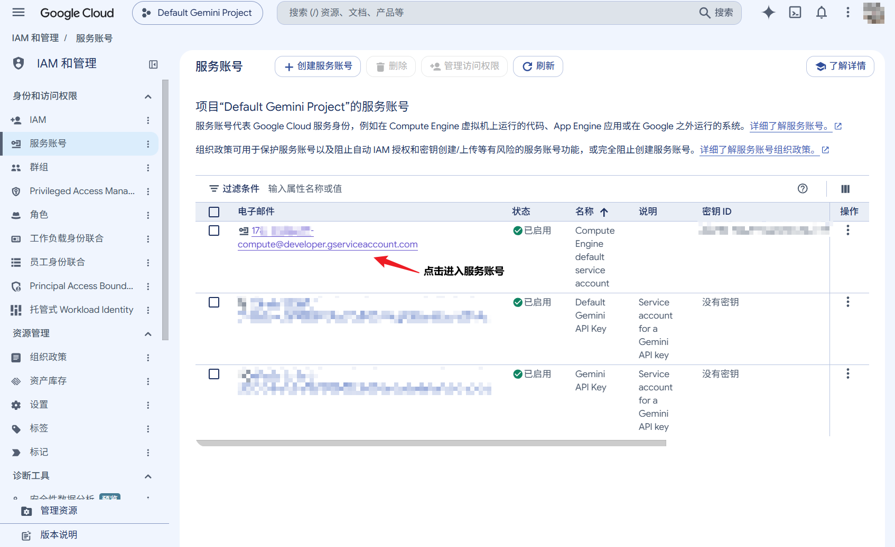
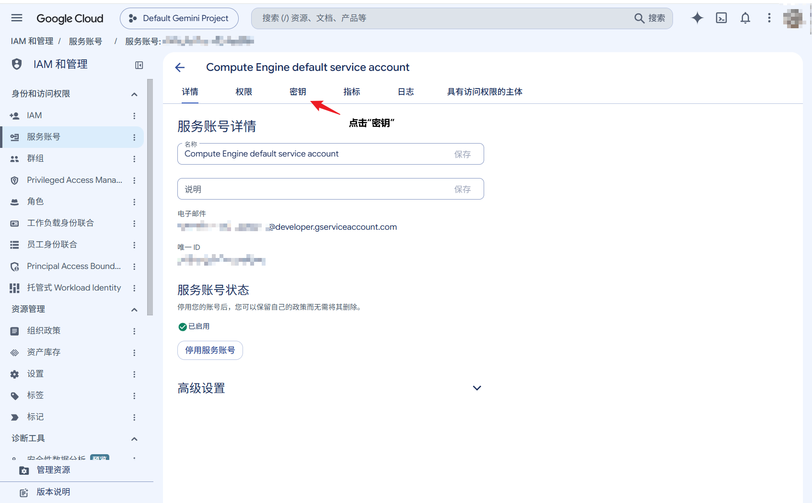
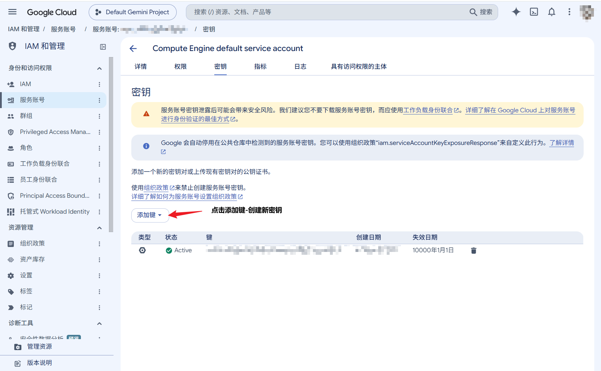
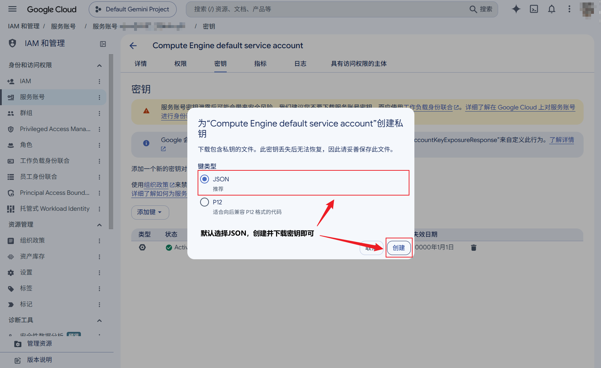

# Vertex Batch Studio

[简体中文](README.md) | **English**

A Windows desktop workspace for **Google Cloud Vertex AI Batch image generation**. Queue prompts and reference images, monitor jobs, and keep decoded outputs with your project.

[Download Installer (v0.3.5)](https://github.com/veluRiya000/Vertex-Batch-Studio/releases/tag/v0.3.5) · [Changelog](docs/changelog-v0.3.5.md#english) · [Report an Issue](https://github.com/veluRiya000/Vertex-Batch-Studio/issues)

> **New here? [Open the illustrated Google Cloud setup guide: Project ID, storage bucket, and JSON key](#google-cloud-setup-guide)**

The previous build that includes Harness is preserved on the [feature/harness-batch branch](https://github.com/veluRiya000/Vertex-Batch-Studio/tree/feature/harness-batch) and in the [v0.3.4 release](https://github.com/veluRiya000/Vertex-Batch-Studio/releases/tag/v0.3.4).

---

## Interface Showcase

### 1. Batch Image Generation Workspace



- **Left Sidebar (Projects & Shared Reference Library)**: The project list displays 6 items by default (expandable to show all) with one-click ascending/descending creation-time sorting. Below it, the shared reference library supports **custom categories** (right-click to create/delete categories or move cards between categories), list/grid switching, and drag-and-drop import.
- **Center Stage (Conversation Stream & Composer)**: Inspect multi-round generation history, 4-up image grids, job progress, and raw payload actions. The bottom composer lets you attach references, configure aspect ratio/resolution/image count, and submit additional batch rounds without waiting for earlier rounds to finish.
- **Right Sidebar (Generation Queue)**: Tasks receive stable creation-order badges (`01`, `02`, ...) that remain fixed even when toggling ascending/descending creation-time sort.

### 2. Cloud Configuration & Project Archive Management

| Google Cloud Credentials & Connection Check | Project Archive & Direct Folder Access |
| --- | --- |
|  |  |
| Configure your Project ID, GCS Bucket, and Service Account JSON key once for both modes, with quick console links and connection verification. | Archive any project not actively generating/transferring, open archived project folders directly in Explorer, restore projects, or delete them permanently. |

---

## Key Features

### 1. Batch Image Generation

- **Automatic Model Discovery & Hot Updates**: Dedicated image model catalog with configurable aspect ratio, resolution, image count (1–4 per task), and model-specific parameters. Automatically probes available image models with a multi-stage fallback chain (`Google official docs → maintainer online catalog → local cache → bundled snapshot`), enabling model list updates without reinstalling the app.
- **Multi-Image Tasks & Asset Reuse**: Requesting multiple images in a single task submits independent generation requests within the same cloud Batch job and groups the results into one conversation entry. Prompts, parameters, and GCS reference URLs are automatically reused across the batch without redundant uploads.
- **Shared Reference Library with Custom Categories**: Create and delete custom reference categories via right-click, and move any reference card with the right-click **"Move to category"** menu (cards from deleted categories automatically fall back to **Uncategorized**, which hides itself when empty). Switch between list and grid views, drag to reorder, preview full-size images, and add assets directly to your active prompt.
- **Time-Sorted Projects & Numbered Queue**: Both the project list (showing 6 items by default with an expand toggle) and the generation queue support ascending/descending creation-time sorting with a highlighted direction badge. Queue items are assigned stable creation-order numbers (`01`, `02`, ...) that stay intact when re-sorted.
- **Multi-Round Concurrent Submission & Dual-Directory Saving**: Continue queueing and submitting new rounds in the same project while previous batches are still running. Decoded images are saved to the project's internal folder first and then copied to your custom external output directory, with instant preview refresh when re-decoding raw payloads.
- **Flexible Layout & Broadened Archiving**: Freely resize the sidebar and reference library, or collapse the project list and generation queue. Any project without an actively generating or transferring batch (`uploading`, `submitting`, `submission_unknown`, `monitoring`, `downloading`) can be archived, and archived project folders can be opened directly from **Settings → Archive**.

> **Note**: The selected image count controls the number of cloud requests submitted, not a guaranteed number of returned images. Content filtering or failed requests may result in fewer images (if a single request returns multiple images, all are saved). Failed requests are never automatically resubmitted at extra cost.

- **Long project histories**: Open the latest 20 task cards first, scroll back to older tasks, or jump to any task from the queue. Previews load near the viewport; click to open the original.

### 2. Desktop Experience & Notifications

- **Desktop Integration & Clean Process Lifecycle**: Light/dark themes, English/Chinese UI, system tray support, launch at login, and start minimized. The backend process is bound to a Windows Job Object so closing the app or running an in-place installer upgrade cleanly terminates all spawned processes without leaving orphan Python services behind.
- **Native Windows Notifications (Enabled by Default)**: Get notified after each batch or when all queued batches finish, with optional failure alerts.
- **Custom Notification Sounds**: Includes 3 built-in alert sounds (with preview) plus support for importing custom WAV or MP3 files.
- **Shared Cloud Configuration**: Google Cloud connection settings are managed in one place, complete with quick-launch console links next to the Project, Bucket, and Credential fields.

---

## Getting Started

### 1. Download & Install

1. Visit the [v0.3.5 Release page](https://github.com/veluRiya000/Vertex-Batch-Studio/releases/tag/v0.3.5) and download `VertexBatchStudio-Setup-0.3.5-x64.exe`.
2. Run the installer to perform a fresh install or an in-place upgrade (the installer automatically closes any running instance of the app before upgrading).
3. Launch the application, and configure Google Cloud.

*System Requirements: Windows x64. No separate Python, Node.js, or Rust installation is needed. Uses system WebView2 (downloaded automatically during setup if missing). The installer is currently unsigned; SHA-256 checksums are provided on the release page.*

### 2. Configure Google Cloud

Before running cloud models, complete the following one-time setup:

1. **Enable API**: Prepare a Google Cloud project with Billing and the **Vertex AI API** enabled, ensuring access to your target models.
2. **Create a Storage Bucket**: **Create a Cloud Storage bucket first** to store reference assets, Batch input payloads, and output results.
3. **Prepare Service Account Credentials**: Create a service account JSON key with Vertex AI Batch and Storage bucket permissions (ensure the Vertex AI Service Agent also has access to bucket objects).
4. **Connect in App**: Open **Settings → Google Cloud sign-in**, enter your Project ID and Bucket Name, import the JSON key file, and click **Check connection**.

---

## Google Cloud Setup Guide

The screenshots below use the Chinese Google Cloud console. The accompanying instructions name the corresponding English controls.

### Project ID: where to copy it

Open the Google Cloud console dashboard for your project and copy the value next to **ID** into the app's **Project ID** field. Use the project ID, rather than its display name or numeric project number.



### Storage bucket: where to find its name

Create or select a bucket under **Cloud Storage → Buckets**, then copy its name into the app's **Bucket** field. The highlighted rows show bucket names; use the actual name from your own project.



### Service account JSON key: how to create and download it

1. Open **IAM & Admin → Service Accounts** and choose a service account with the required permissions. If needed, click **Create service account**. The default service account shown in the screenshot is an example, not a requirement.

   

2. Click the target service account's email address to open its details.

   

3. Select the **Keys** tab.

   

4. Click **Add key → Create new key**.

   

5. Choose **JSON** and click **Create** to download the key file. In the app, open **Settings → Google Cloud sign-in → Import JSON key** and select the downloaded file. It does not need to be renamed to `key.json`. Keep the key file local; do not commit it to GitHub.

   

---

## Workflows

### Image Generation

```text
Create Project → Enter Prompt & References → Select Model & Settings → Add Task
                                                                          ↓
                                                            Submit Tasks Manually
                                                                          ↓
                                         Cloud Queue (additional rounds can be submitted anytime)
                                                                          ↓
                                           Dual-Directory Save → Preview & Re-Decode
```

- **Batching & Multi-Round Submissions**: Clicking **Add task** adds an entry to the current draft batch. A batch can hold multiple tasks, each expanding into the selected number of cloud requests upon submission (e.g., 2 tasks requesting 4 images each appear as 2 conversation items and submit 8 JSONL requests). Once submitted, you can immediately queue and submit new batch rounds in the same project while earlier rounds are still running.
- **Archiving & Folder Access**: Any project without an actively generating/transferring batch can be archived via right-click (including completed, draft, failed, paused, or unconfirmed batches). Archived projects can be opened directly in File Explorer, restored, or deleted from **Settings → Archive**.

## Data Storage & Recovery

The installed Windows app stores user data in a dedicated directory (retained by default upon uninstallation):

```text
%APPDATA%/VertexBatchStudio/
├── settings.json             # Appearance, desktop behavior, model cache, and notification settings
├── secrets/                  # Imported service account credentials
├── data/
│   ├── references/           # Shared reference image library and custom category metadata
│   ├── batches/              # Image inputs, raw payloads, internal decoded images, and logs
│   ├── archive/              # Archived image projects
│   └── notifications/        # Custom alert sounds and notification history
└── .runtime/                 # Local runtime and connection state
```

- **Minimize to Tray**: Background polling and completion notifications continue running normally.
- **Exit or Shut Down**: Local tools and download monitors stop, while jobs already submitted to Google Cloud continue running remotely.
- **Restart Recovery**: On relaunch, Image Generation automatically resumes job polling, downloading, and decoding.
- **Archiving & Deletion**: Archiving or deleting projects only removes local files and does not delete objects in Google Cloud Storage.

---

## Costs

- The title bar opens Google Cloud Billing Reports and Credits in your browser. Google Cloud Billing shows final charges, credits, and discounts.

---

## Build & Run from Source

### 1. Clone the Repository

```powershell
git clone https://github.com/veluRiya000/Vertex-Batch-Studio.git
cd Vertex-Batch-Studio
```

### 2. Environment & Dependencies

- **Python 3.12** (dependencies locked via `requirements.lock.txt`)
- **Node.js 22.12+ and npm**
- **Rust toolchain**, Visual Studio C++ Build Tools, and Windows SDK (required for desktop compilation)

```powershell
python -m venv .venv
.\.venv\Scripts\python.exe -m pip install -r requirements.lock.txt
.\.venv\Scripts\python.exe -m pip install --no-deps -e .
Copy-Item .env.example .env
cd frontend
npm.cmd ci
cd ..
```

Configure cloud settings for source development in `.env` (`VERTEX_MODEL` sets the default image model):

```dotenv
GOOGLE_CLOUD_PROJECT=your-project-id
GCS_BUCKET=your-storage-bucket
GOOGLE_CLOUD_LOCATION=global
VERTEX_MODEL=gemini-3.1-flash-image
GOOGLE_APPLICATION_CREDENTIALS=secrets/service-account.json
VBS_DATA_DIR=data
VBS_POLL_SECONDS=30
```

### 3. Run in Development Mode

To run the image backend and web frontend in two terminals:

```powershell
# Terminal 1 (repository root)
.\.venv\Scripts\python.exe -m backend serve

# Terminal 2 (frontend directory)
npm.cmd run dev
```

For desktop development, run `npm.cmd run desktop` inside `frontend/`.

### 4. Build the Windows Installer

Run from the repository root:

```powershell
powershell -ExecutionPolicy Bypass -File packaging/build-windows.ps1 -Python .venv/Scripts/python.exe
```

Installer artifacts are written to `release/`.

### 5. Project Structure & Tests

| Directory | Contents |
| --- | --- |
| `backend/` | FastAPI server, image batching, model catalog discovery, and notifications |
| `frontend/src/` | Web UI, workspace, and settings |
| `frontend/src-tauri/` | Tauri desktop windowing, tray integration, Job Object process management, and native bridges |
| `packaging/` | Backend freezing and combined Windows installer scripts |
| `tests/`, `docs/` | Automated backend tests and technical documentation |

```powershell
# Run backend tests (from repository root, using temporary data and mock cloud)
.\.venv\Scripts\python.exe -m unittest discover -s tests -t . -v

# Run frontend tests and build (from frontend directory)
npm.cmd test
npm.cmd run build
```

The backend CLI also remains available via `python -m backend --help`.

---

## Documentation

- [Local API & Image Workflows](docs/API.md)
- [Completion Notifications](docs/COMPLETION_NOTIFICATIONS.md)
- [Windows Packaging](packaging/README.md)

*(Note: Some linked technical documents are currently available in Chinese only.)*

---

## Feedback & Licensing

- **Issues & PRs**: When reporting an issue, please include the app version, reproduction steps, and sanitized logs (**never upload service account keys, access tokens, or unredacted private sessions**). Pull requests should target the active development branch.
- **License**: This repository does not currently include a project-wide `LICENSE` file; usage and redistribution are subject to the maintainer's terms.
- **Disclaimer**: Google Cloud, Vertex AI, and Gemini are trademarks or products of their respective owners. This project is not affiliated with or endorsed by Google.
