# Vertex Batch Studio

**简体中文** | [English](README.en.md)

面向 **Google Cloud Vertex AI Batch** 的 Windows 桌面工作台，将**批量生图**与 **Harness 本地 Agent** 集成在同一个原生桌面应用中，该 Harness 经过 Batch API 调用深度适配。*注意：经过实测，批量推理下，Gemini 4 Argon 等推理模型速度较慢、等待时间较长，仅适合一次性大批量处理代码或长文档任务（例如本应用前端页面由 Gemini 4 Argon 优化，耗时 1h15min）。*

[下载安装包 (v0.3.3)](https://github.com/veluRiya000/Vertex-Batch-Studio/releases/tag/v0.3.3) · [功能源码](https://github.com/veluRiya000/Vertex-Batch-Studio/tree/feature/harness-batch) · [问题反馈](https://github.com/veluRiya000/Vertex-Batch-Studio/issues)

> **首次使用？[点击查看 Google Cloud 图文配置教程：项目 ID、存储桶、JSON 密钥](#google-cloud-配置图解)**

> **版本说明（v0.3.3）**
> 单个安装包（约 **69.5 MB**）已内置批量生图模块、Harness、Python 后端及 Node.js 运行时，开箱即用，无需额外部署环境。支持覆盖升级自动关闭旧进程，并在退出时通过 Windows Job Object 自动回收后台服务。当前最新功能源码位于 `feature/harness-batch` 分支。

---

## 核心模式

应用左上角可一键切换 **生图** 与 **Harness** 两种工作模式（生图采用清爽蓝调主题，Harness 采用暖色工作台主题），切换视图不会中断后台正在运行的任务。*Harness 能读图，但不能用来生图，目前暂不支持读取视频。*

| 模式 | 适用场景 | 执行方式 |
| --- | --- | --- |
| **批量生图** | 批量抽卡、角色/风格参考图分类复用、生成结果双目录落盘与归档管理 | 添加多个任务后，手动点击提交批次（支持同项目多轮并发提交） |
| **Harness Agent** | 本地文件处理、文档编写、代码修改、PowerShell 命令执行 | 启动任务后，自动执行“模型 → 工具 → 模型”批处理循环 |

> **关于 Harness**：复用了 [DeepSeek Harness](https://github.com/deepseek-ai/deepseek-harness) 的会话、工具与权限审批机制，底层模型推理则全部接入 Google Cloud Batch，无需配置 DeepSeek API Key。

---

## 界面展示

### 1. 批量生图工作台

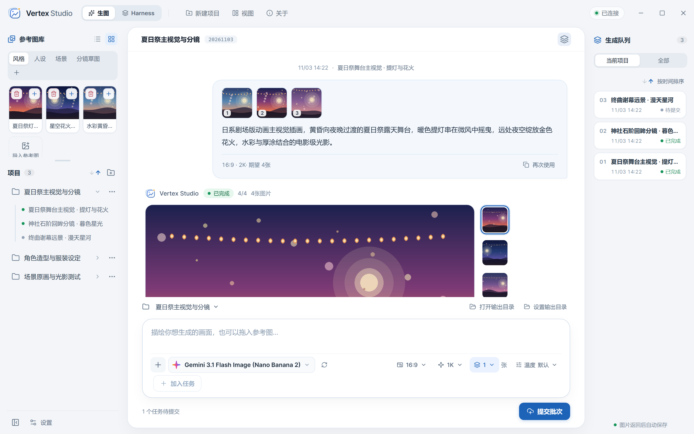

- **左侧栏（项目列表与公共参考图库）**：上方项目列表默认展示 6 个项目（可展开查看全部），支持按创建时间正序/倒序一键切换；下方公共参考图库支持**自定义分类管理**（右键新建/删除分类、右键卡片“移至分类”）、网格/列表切换及拖拽导入。
- **中间区域（对话流与底部创作台）**：展示当前项目的历史生成轮次、四宫格缩略图预览、任务状态与下载入口；底部创作台支持拖入参考图、设置画面比例/分辨率/张数，并支持在同一项目下连续提交新一轮任务。
- **右侧栏（生成队列）**：按创建顺序为每条任务生成固定编号（`01`、`02`...），支持按创建时间正序/倒序排列而保持原有编号不变。

### 2. Harness 本地 Agent 工作台

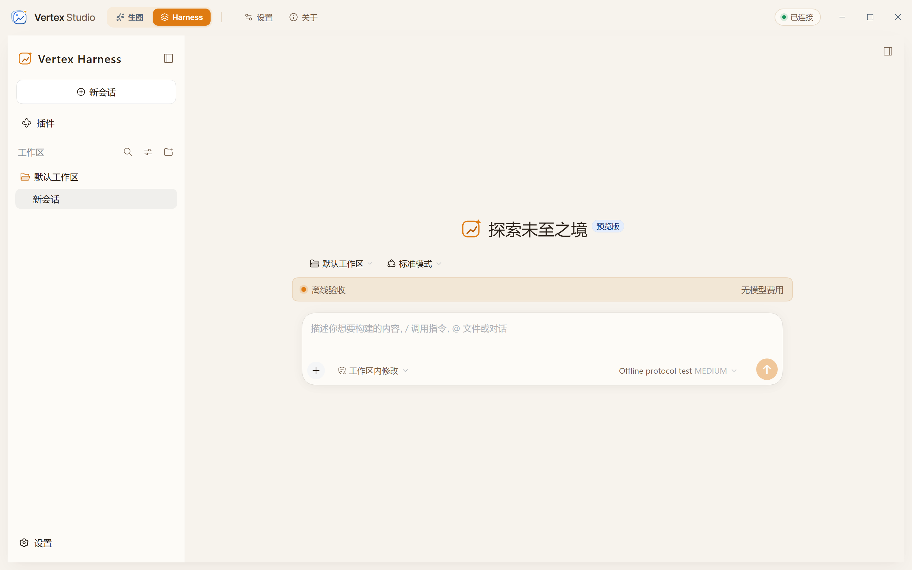

- **原生内嵌工作区**：在顶部标题栏切换至 `Harness` 模式后，直接在同一窗口内管理本地工作目录、多轮会话、模型选择与权限策略（只读 / 自动编辑 / 完全自主等）。
- **批处理状态透明化**：实时显示当前 Batch 作业排队进度、工具执行日志、文件变更记录与预估调用成本。

### 3. 云端配置与项目归档管理

| Google Cloud 凭证与连接检查 | 项目归档管理与目录直达 |
| --- | --- |
| 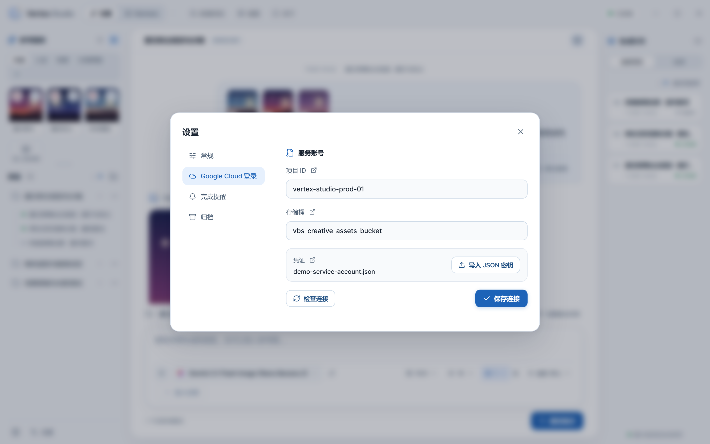 | 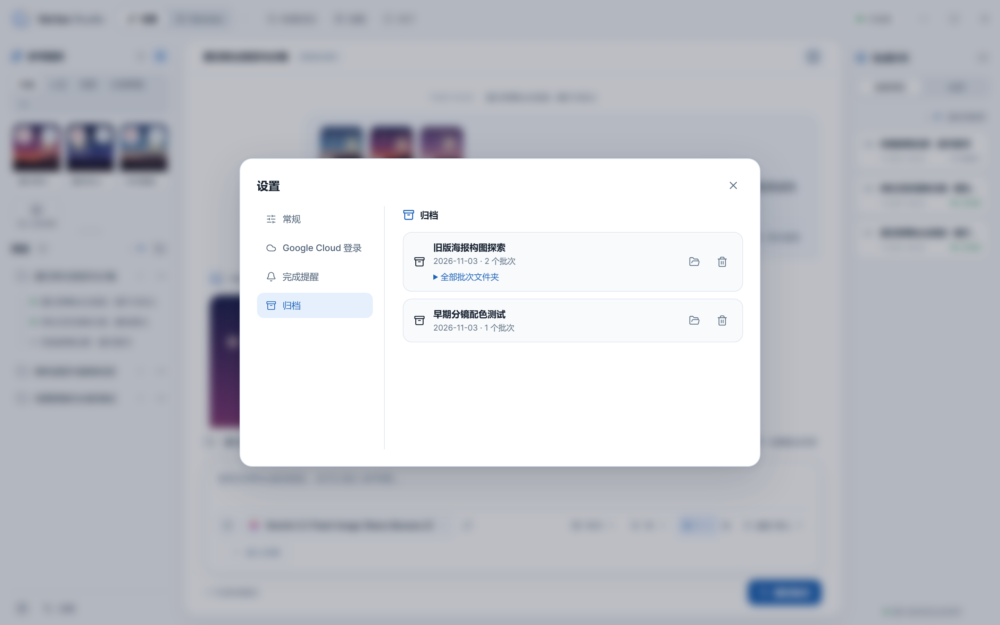 |
| 一处配置项目 ID、GCS 存储桶与服务账号 JSON 密钥，生图与 Harness 双模式共用，内置控制台快捷跳转与连接检查。 | 支持对所有非正在生成/传输中的项目进行归档；可在归档面板中一键打开项目本地文件夹、恢复至工作台或彻底删除。 |

---

## 功能特性

### 1. 批量生图

- **多模型自动探测与热更新**：提供独立的生图模型列表，支持自定义画面比例、分辨率、单次生成数量（1–4 张）及模型特定参数；支持自动探测可用生图模型，并具备“Google 官方文档 → 维护者在线模型清单 → 本地缓存 → 安装包内置列表”多级回退机制，无需重装软件即可热更新模型列表。
- **单任务多图与素材复用**：单次任务选择生成多张图片时，会在同一云端 Batch 作业中并发提交多条独立请求，并在界面中聚合展示；同一批次内自动复用提示词、参数及参考图的 GCS 地址，避免重复上传素材。
- **公共参考图库与自定义分类**：除默认分类外，支持右键分类栏自由新建、删除自定义分类，右键任意参考图通过“移至分类”快速归类（删除分类后图片自动归入“未分类”，无未分类图片时自动隐藏该标签）；支持列表/网格视图切换、拖拽排序、大图预览及一键填入当前任务。
- **项目与队列时间排序**：左侧项目列表（默认展示 6 项，可展开）与右侧生成队列均支持按创建时间正序/倒序切换，按钮高亮指示当前排序方向；队列任务按创建顺序生成固定序号（`01`、`02`...），切换排序时序号保持不变。
- **同项目多轮并发与双目录落盘**：同一项目在已有任务运行期间仍可继续添加并提交新任务，多轮任务并行执行；生成结果优先保存至项目自带目录，随后自动复制至外部自定义输出目录，支持基于本地原始返回数据即时重新解码并刷新预览。
- **灵活界面布局与归档管理**：支持拖拽调整侧边栏与参考图库区域大小，随时收起项目列表与生成队列；除正在上传/提交/生成/下载中的状态外，其余项目状态均可随时归档，且支持在“设置 → 归档”中直接打开归档项目的本地文件夹。

### 2. Harness Agent

- **工作区与会话持久化**：绑定本地工作目录，完整保留对话上下文、附件、工具调用结果及文件修改记录。
- **文件与命令行工具**：支持本地文件的读取、检索、创建与编辑，支持执行 PowerShell 命令并展示交付结果。
- **权限控制与安全审批**：支持 DSH 权限模式切换、Windows 沙盒隔离及越界操作审批；内置文件版本检查，防止覆盖外部已修改的内容。
- **多模态附件与文本预读**：支持拖拽导入图片及文本附件（自动预读大小受限的文本附件，减少模型为读取材料而额外耗费的 Batch 轮次；暂不支持视频输入）。
- **扩展与自定义**：支持在设置中自定义角色提示词（Persona），支持手动配置 Skills 与 MCP 服务（默认不连接外部 MCP）。
- **批处理监控与本地限额**：实时展示执行步骤、等待耗时、作业状态、估算费用及预留金额；支持按需开启本地预算、请求次数及自定义输出额度限制（默认关闭）。

**内置 Harness 模型列表：**

| 界面显示名称 | API 模型 ID |
| --- | --- |
| Gemini 4 Argon | `gemini-4-argon` |
| Gemini 3.8 Flash | `gemini-3.8-flash` |
| Gemini 3.1 Pro Preview | `gemini-3.1-pro-preview` |

*注：实际可用性取决于你的 Google Cloud 项目权限、模型支持情况及所选区域。生图与 Harness 各自独立保存模型选择。*

### 3. 桌面体验与完成通知

- **桌面集成与干净退出**：支持浅色/深色主题、中英双语切换、系统托盘驻留、开机自启及启动时最小化；底层通过 Windows Job Object 绑定后端与 Harness 子进程，关闭主程序或覆盖升级时自动清理所有派生的后台进程，无残留占用。
- **Windows 原生通知（默认开启）**：生图与 Harness 队列独立统计、互不阻塞；支持设置“每批完成提醒”或“同类任务全部完成提醒”，并可选择是否包含失败提醒。
- **自定义提示音**：内置 3 种提示音（支持试听），支持导入自定义 WAV / MP3 音频。
- **共享云端连接**：两种模式共用一套 Google Cloud 凭证配置。

---

## 快速上手

### 1. 下载与安装

1. 前往 [v0.3.3 Release 页面](https://github.com/veluRiya000/Vertex-Batch-Studio/releases/tag/v0.3.3) 下载 `VertexBatchStudio-Setup-0.3.3-x64.exe`。
2. 运行安装程序完成安装或覆盖升级（安装向导会自动检测并关闭正在运行的旧版进程）。
3. 启动应用，进入设置，完成 Google Cloud 配置后即可选择模式开始使用。

*系统要求：Windows x64。安装版无需本地配置 Python、Node.js 或 Rust；依赖系统 WebView2（若缺失，安装向导会自动下载）。安装包暂未进行数字签名，Release 页面提供 SHA-256 校验值。*

### 2. 配置 Google Cloud

首次使用云端模型前，请完成以下准备：

1. **启用 API**：准备一个已启用结算（Billing）和 **Vertex AI API** 的 Google Cloud 项目，并确保拥有目标模型的访问权限。
2. **创建存储桶**：在 Cloud Storage 中**预先创建一个存储桶（Bucket）**，用于存放参考图素材、Batch 输入文件及返回结果。
3. **配置服务账号密钥**：创建服务账号并导出 JSON 密钥，赋予其 Vertex AI Batch 操作及存储桶读写权限（同时确保 Vertex AI Service Agent 具备该存储桶的访问权限）。
4. **导入软件**：打开软件 **设置 → Google Cloud 登录**，填入项目 ID（Project ID）、存储桶名称并导入 JSON 密钥，点击 **检查连接** 验证。

---

## Google Cloud 配置图解

### 项目 ID：在哪里复制？

打开目标项目的 Google Cloud 控制台首页，复制 **ID** 一栏的值，填入软件的“项目 ID”。这里填写的是项目 ID，而非项目显示名称或项目编号。

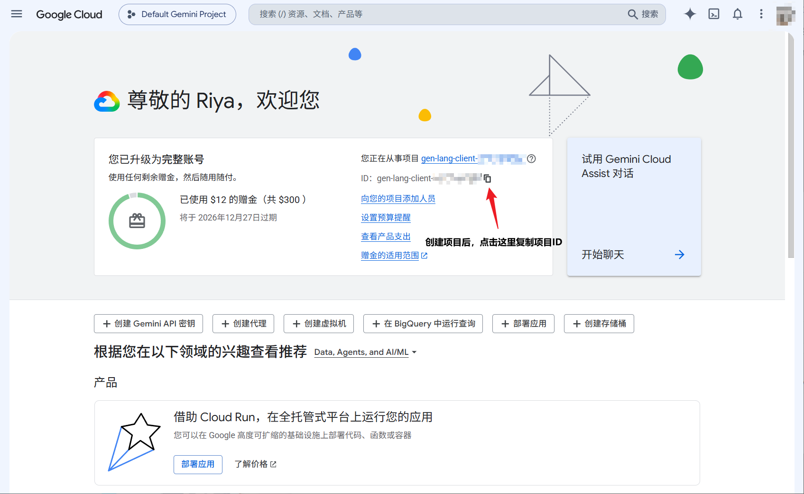


### 存储桶：在哪里查看名称？

在 **Cloud Storage → 存储桶** 中创建或选择一个存储桶，复制其名称，填入软件的“存储桶”。图中框选的是存储桶名称，请使用自己项目中的实际名称。

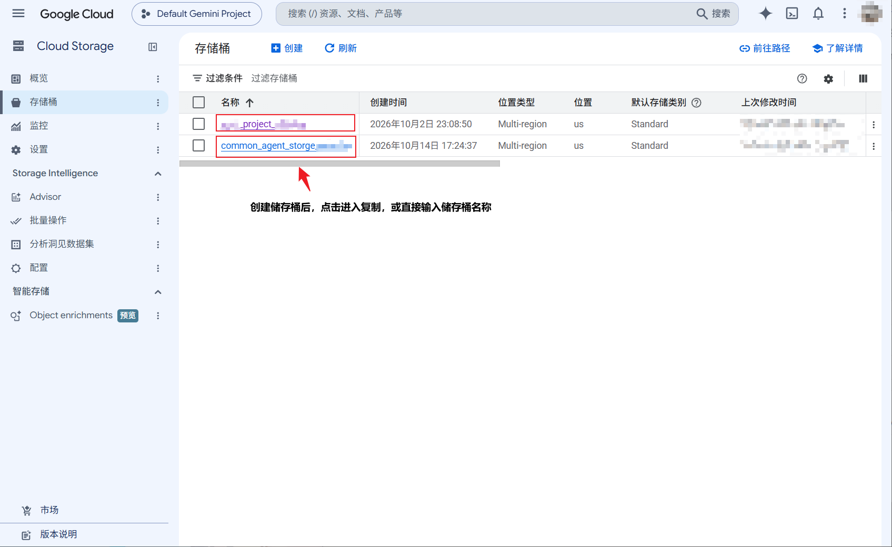


### 服务账号 JSON 密钥：如何创建并下载？

1. 打开 **IAM 和管理 → 服务账号**，选择具备所需权限的服务账号；若尚未创建，点击 **创建服务账号**。截图使用默认服务账号演示，并不要求必须使用该账号。

   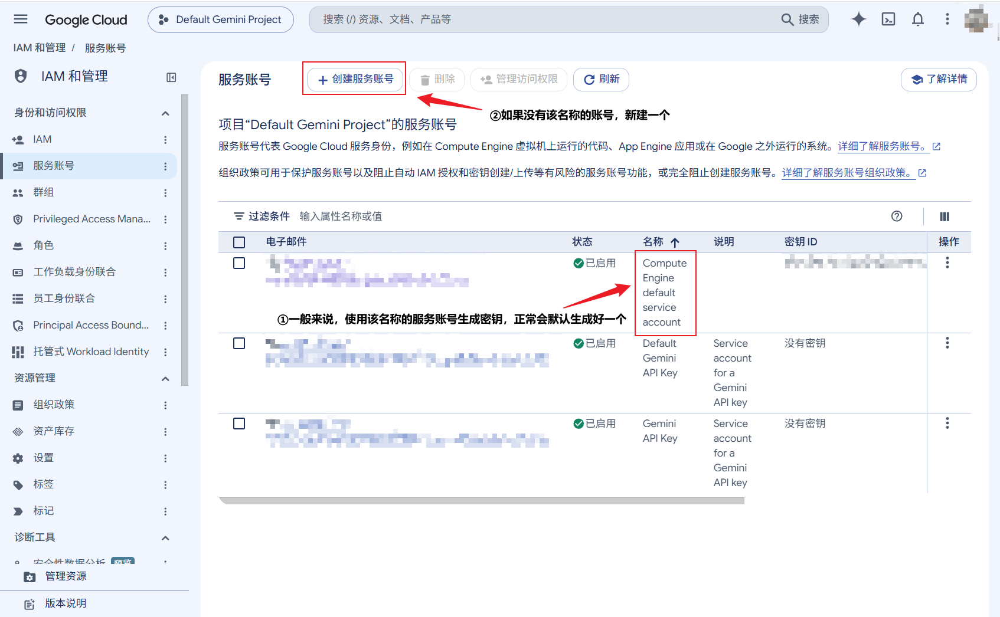

2. 点击目标服务账号的邮箱，进入详情页。

   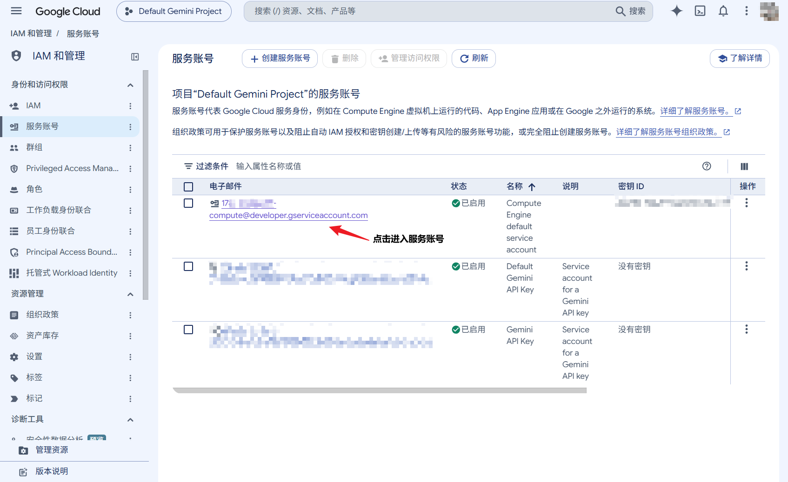

3. 切换到 **密钥** 标签页。

   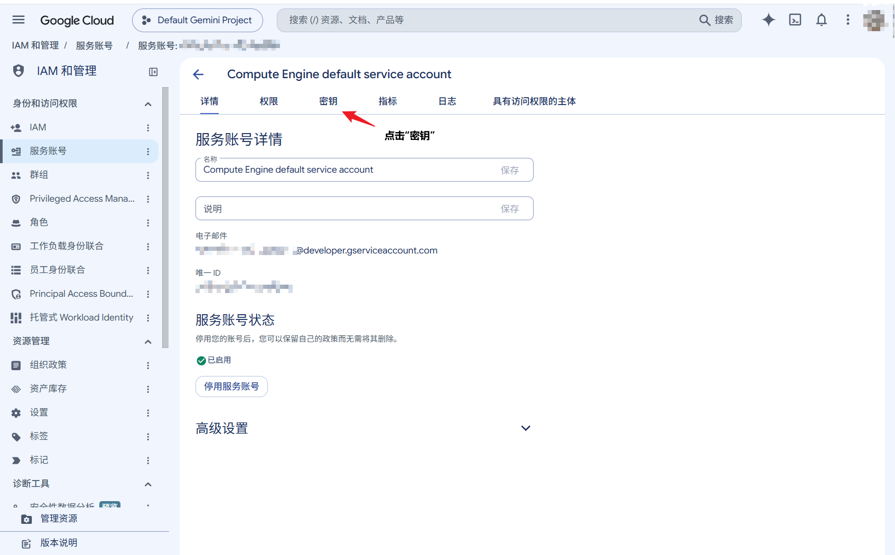

4. 点击 **添加键 → 创建新密钥**。

   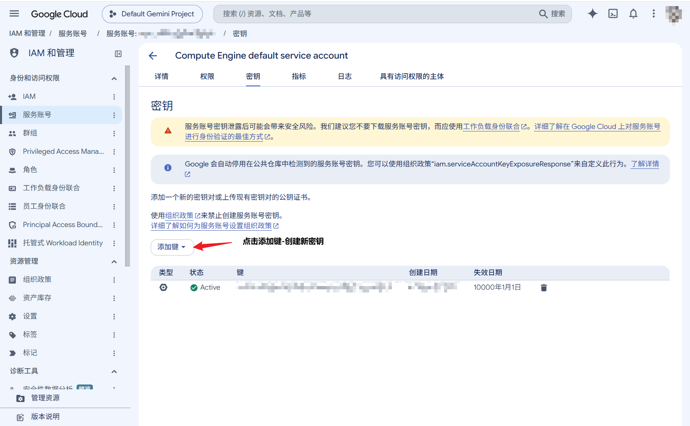

5. 选择 **JSON**，点击 **创建**，浏览器将下载密钥文件。回到软件 **设置 → Google Cloud 登录 → 导入 JSON 密钥**，选择刚下载的文件即可，文件名不需要改成 `key.json`。密钥文件仅保存在本地，不要提交到 GitHub。

   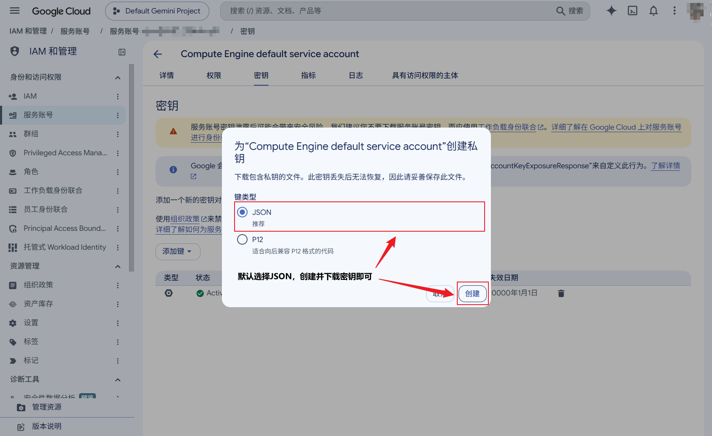


---

## 工作流程

### 批量生图流程

```text
新建项目 → 输入提示词与参考图 → 选择模型与参数 → 加入任务
                                                  ↓
                                       手动点击“提交任务”
                                                  ↓
                                 云端排队（期间可继续追加新一轮任务）
                                                  ↓
                                   自动双目录落盘 → 预览与重新解码
```

- **批次组合与并发追加**：点击“加入任务”会在当前待提交批次下创建一条任务。一个批次可包含多个任务，提交时将按所选张数展开为对应数量的 JSONL 请求（例如：2 个各生 4 张图的任务，界面显示为 2 条记录，实际提交 8 条云端请求）。上一轮批次提交后，无需等待其完成即可在同一项目内继续组队并提交新一轮批次。
- **项目归档与目录直达**：只要项目下没有正在上传、提交、云端生成或下载中的批次，右键项目即可随时归档（包含已完成、草稿、失败、暂停或提交未确认等状态）。已归档项目可在 **设置 → 归档** 中一键打开本地文件夹、恢复或彻底删除。

### Harness 流程

```text
切换至 Harness → 选择本地工作区 → 输入任务与附件 → 选择模型与权限 → 开始执行
                                                                     ↓
                                                        Batch 返回 → 本地工具 / 审批
                                                                     ↓
                                                          按需继续下一轮 → 最终交付
```

- **异步批处理机制**：所有模型推理均通过 Google Cloud Batch 执行，不会自动降级为实时 API。界面会实时更新状态与本地工具日志，但模型回复需等待当前 Batch 作业完成，并非逐 Token 实时流式输出。
- **高效提问建议**：由于存在前后依赖的工具调用会触发多轮 Batch 排队，建议在初始提示词中一次性说清目标、输入材料、输出路径及验收标准，以减少交互轮次。

---

## 数据存储与状态恢复

Windows 安装版将用户数据独立保存在以下目录（卸载程序时默认保留）：

```text
%APPDATA%/VertexBatchStudio/
├── settings.json             # 外观、桌面行为、模型缓存与提醒设置
├── secrets/                  # 导入的服务账号凭证
├── data/
│   ├── references/           # 公共参考图库与自定义分类配置
│   ├── batches/              # 生图输入、原始结果、项目内输出图片与日志
│   ├── archive/              # 已归档的生图项目
│   ├── harness/              # 会话记录、附件、调度账本与原始模型返回
│   └── notifications/        # 自定义提示音与通知记录
└── .runtime/                 # 本机连接与运行时状态
```

- **最小化到托盘**：后台任务监控与完成提醒继续正常运行。
- **完全退出或关机**：本地工具执行与下载监控停止，但已提交至云端的 Batch 作业仍会在云端继续运行。
- **重启恢复**：重启软件后，生图模块会自动恢复进度监控、结果下载与解码；Harness 会核对已提交请求的状态，但不保证中断的复杂 Agent 轮次能够无缝续接（有副作用的操作请勿盲目重跑）。
- **归档与清理**：归档或删除项目仅管理本地文件，不会删除 Google Cloud Storage 中的云端对象。

---

## 费用、限额与边界说明

- **费用估算**：界面区分**估算用量费用**与**提交前预留额度**。预留额度仅用于本地计算，不代表实际扣款；赠金抵扣、折扣及最终账单均以 Google Cloud Billing 为准。
- **本地运行限额**：启用本地预算或请求次数限制后，仅约束后续新提交的请求，已提交的云端任务不受影响。关闭本地限额不会扩大文件/命令权限，也不会解除云端本身的配额限制。
- **长输出续传（Argon）**：仅当云端返回有效续传令牌时，Argon 才会尝试续传长文本；若遇到令牌缺失、云端限制或报错则会停止并保留已有结果，不保证单次稳定输出百万 Token。
- **安全与沙盒边界**：截断或格式损坏的工具参数不会被直接执行。Windows 沙盒主要用于约束文件写入，并非完整虚拟机，不提供全面的读取、网络或进程隔离（外部 MCP 服务亦不自动继承沙盒隔离）。

---

## 从源码运行与构建

### 1. 克隆源码

```powershell
git clone --branch feature/harness-batch --recurse-submodules https://github.com/veluRiya000/Vertex-Batch-Studio.git
cd Vertex-Batch-Studio
```

> 若在已有仓库中切换分支，请执行 `git submodule update --init --recursive` 拉取固定版本的 DSH 子模块（直接下载 GitHub 源码 ZIP 包不会包含子模块）。

### 2. 环境准备与依赖安装

- **Python 3.12**（使用 `requirements.lock.txt` 锁定依赖）
- **Node.js 与 npm**（Harness 组件构建脚本固定要求 **Node.js 24.18.0**）
- **Rust 工具链**、Visual Studio C++ Build Tools 及 Windows SDK（仅编译桌面端时需要）

```powershell
python -m venv .venv
.\.venv\Scripts\python.exe -m pip install -r requirements.lock.txt
.\.venv\Scripts\python.exe -m pip install --no-deps -e .
Copy-Item .env.example .env
cd frontend
npm.cmd ci
cd ..
```

源码模式下可通过 `.env` 配置默认连接参数（`VERTEX_MODEL` 为生图默认模型）：

```dotenv
GOOGLE_CLOUD_PROJECT=your-project-id
GCS_BUCKET=your-storage-bucket
GOOGLE_CLOUD_LOCATION=global
VERTEX_MODEL=gemini-3.1-flash-image
GOOGLE_APPLICATION_CREDENTIALS=secrets/service-account.json
VBS_DATA_DIR=data
VBS_POLL_SECONDS=30
```

### 3. 启动开发服务

仅调试生图前后端时，可分别在两个终端中运行：

```powershell
# 终端 1（仓库根目录）：启动后端
.\.venv\Scripts\python.exe -m backend serve

# 终端 2（frontend 目录）：启动前端
npm.cmd run dev
```

如需运行桌面开发模式，请在 `frontend/` 目录下执行 `npm.cmd run desktop`。调试 Harness 功能前，请先参照 [Harness 组件构建指南](https://github.com/veluRiya000/Vertex-Batch-Studio/blob/feature/harness-batch/docs/HARNESS_COMPONENT.md) 构建上游源码并生成 `harness/component/`。

### 4. 构建 Windows 安装包

准备好 `harness/component/` 后，在仓库根目录执行：

```powershell
powershell -ExecutionPolicy Bypass -File packaging/build-windows.ps1 -Python .venv/Scripts/python.exe
```

构建产物将输出至 `release/` 目录。

### 5. 目录结构与测试

| 目录 | 说明 |
| --- | --- |
| `backend/` | FastAPI 后端、生图批次管理、模型列表探测、Harness Batch 调度、费用计算与通知服务 |
| `frontend/src/` | 前端生图界面、模式切换与公共设置组件 |
| `frontend/src-tauri/` | Tauri 桌面窗口、托盘控制、Job Object 进程管理与原生系统接口 |
| `harness/plugins/` | Batch 模型适配器、提示词策略与 Harness 主题插件 |
| `harness/upstream/` | 固定版本的 DSH 上游子模块 |
| `packaging/` | 后端冻结与 Windows 合并安装器构建脚本 |
| `tests/`、`docs/` | 后端自动化测试与特性技术文档 |

```powershell
# 运行后端测试（位于仓库根目录，使用临时数据与模拟云端环境）
.\.venv\Scripts\python.exe -m unittest discover -s tests -t . -v

# 运行前端测试与构建（位于 frontend 目录）
npm.cmd test
npm.cmd run build
```

后端亦保留了 CLI 命令行入口，可通过 `python -m backend --help` 查看。

---

## 相关文档

- [本地 API 与生图流程](https://github.com/veluRiya000/Vertex-Batch-Studio/blob/feature/harness-batch/docs/API.md)
- [Harness 功能与权限说明](https://github.com/veluRiya000/Vertex-Batch-Studio/blob/feature/harness-batch/docs/HARNESS_FEATURES.md)
- [内置模型入口说明](https://github.com/veluRiya000/Vertex-Batch-Studio/blob/feature/harness-batch/docs/HARNESS_MODELS.md)
- [长输出续传机制](https://github.com/veluRiya000/Vertex-Batch-Studio/blob/feature/harness-batch/docs/HARNESS_CONTINUATION.md)
- [完成通知机制](https://github.com/veluRiya000/Vertex-Batch-Studio/blob/feature/harness-batch/docs/COMPLETION_NOTIFICATIONS.md)
- [Windows 打包说明](https://github.com/veluRiya000/Vertex-Batch-Studio/blob/feature/harness-batch/packaging/README.md)

---

## 问题反馈与许可说明

- **问题反馈**：提交 Issue 时请附带软件版本号、使用模式、复现步骤及脱敏后的日志（**切勿上传服务账号密钥、访问令牌或包含隐私的会话记录**）。欢迎针对当前开发分支提交 PR。
- **许可证**：本仓库目前暂未提供项目级 `LICENSE` 文件，使用与分发授权以维护者声明为准。其中 `harness/upstream` 子模块固定于提交 `d743267388641bc76f17c45ce8b4c231aed1d32c`，遵循其原有的 MIT 许可证（不自动代表本项目其余代码采用 MIT）。打包运行时保留了相关第三方组件与 Node 许可声明。
- **免责声明**：Google Cloud、Vertex AI 与 Gemini 均为其各自所有者的商标或产品，本项目非 Google 官方产品。