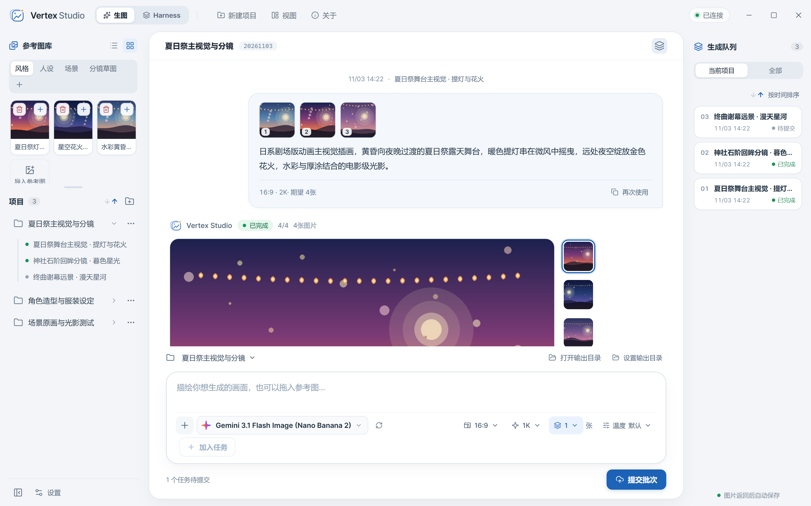
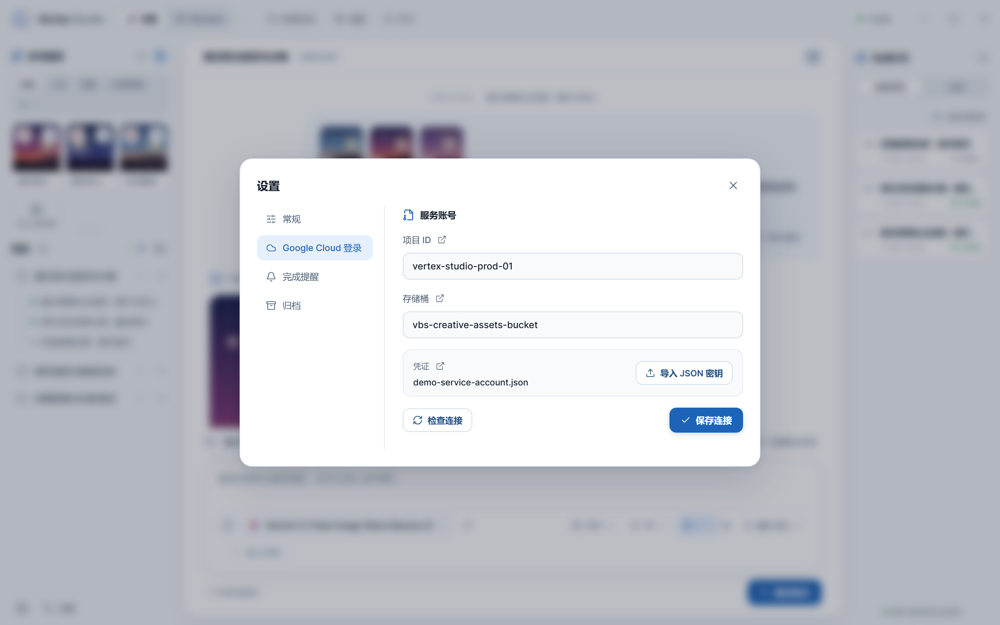
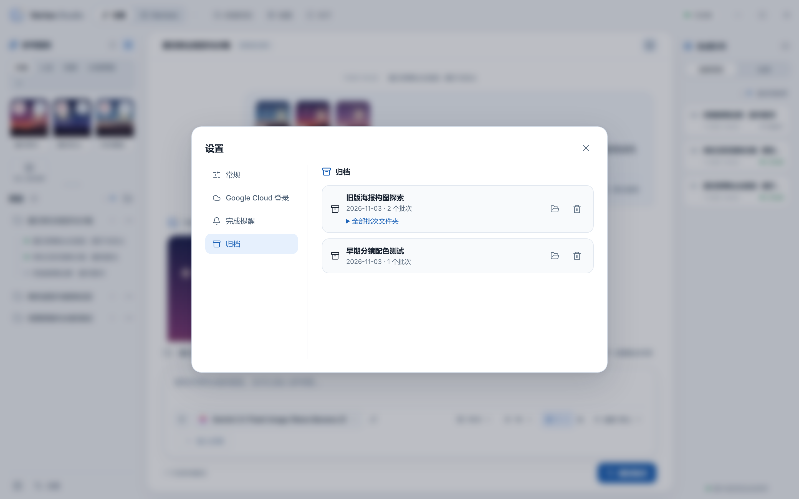
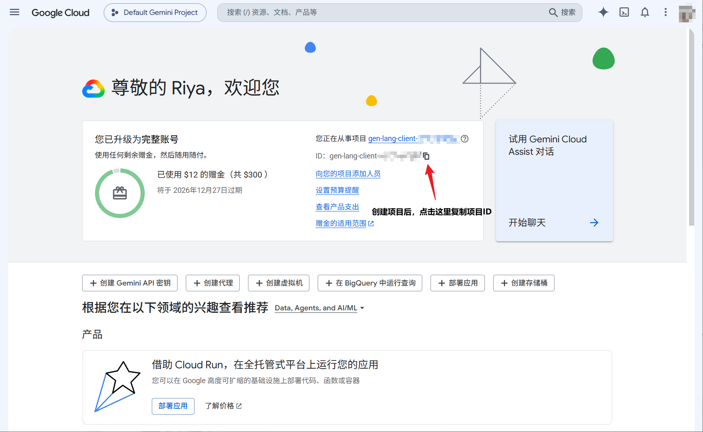
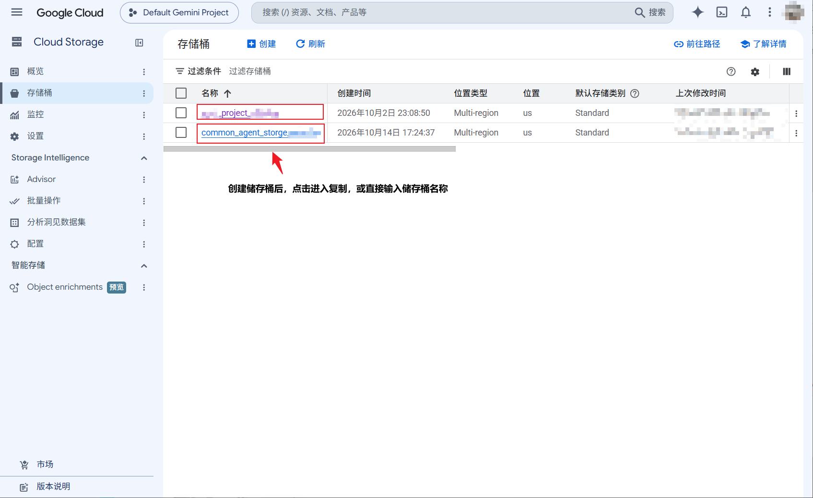
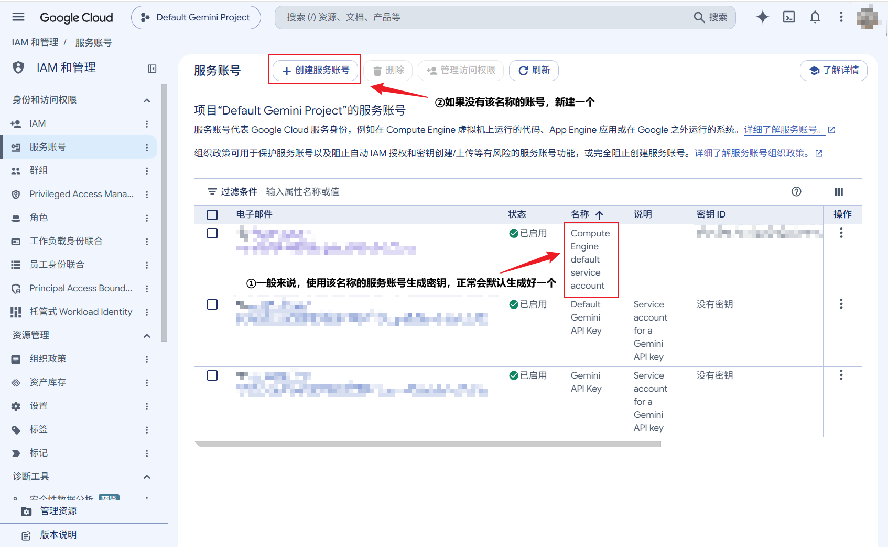
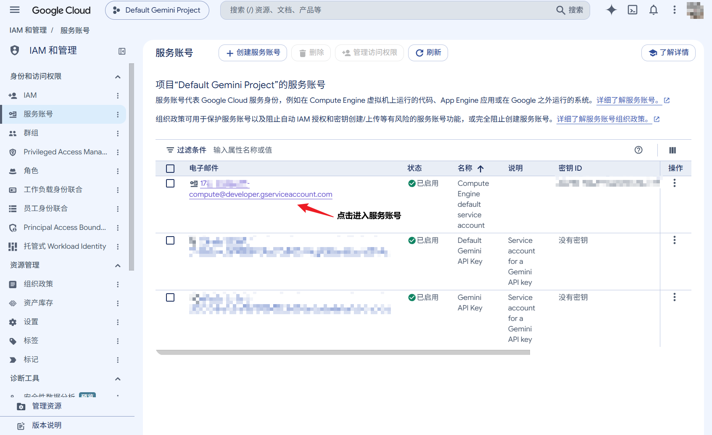
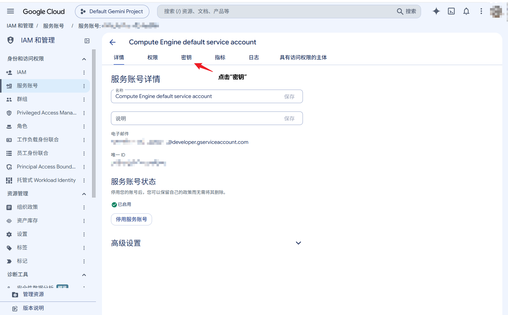
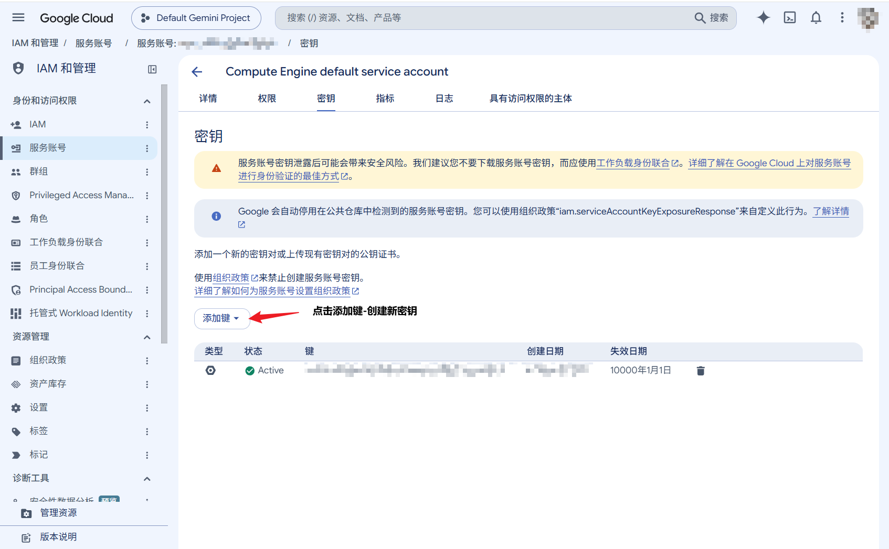
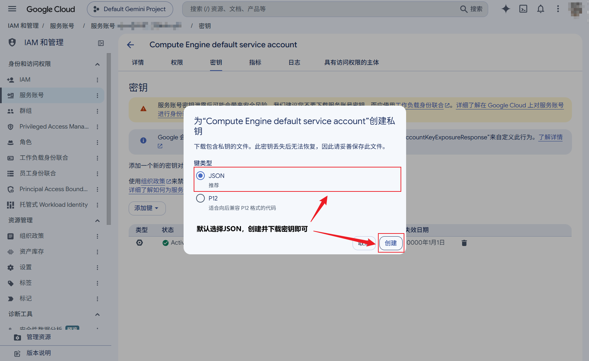

# Vertex Batch Studio

**简体中文** | [English](README.en.md)

面向 **Google Cloud Vertex AI Batch 批量生图** 的 Windows 桌面工作台。可以整理提示词和参考图、一次提交多张图片、追踪云端进度，并把输出留在项目里。

[下载安装包 (v0.3.5)](https://github.com/veluRiya000/Vertex-Batch-Studio/releases/tag/v0.3.5) · [更新日志](docs/changelog-v0.3.5.md) · [问题反馈](https://github.com/veluRiya000/Vertex-Batch-Studio/issues)

> **首次使用？[点击查看 Google Cloud 图文配置教程：项目 ID、存储桶、JSON 密钥](#google-cloud-配置图解)**

含 Harness 的旧版保留在 [feature/harness-batch 分支](https://github.com/veluRiya000/Vertex-Batch-Studio/tree/feature/harness-batch) 和 [v0.3.4 发布页](https://github.com/veluRiya000/Vertex-Batch-Studio/releases/tag/v0.3.4)。

---

## 界面展示

### 1. 批量生图工作台



- **左侧栏（项目列表与公共参考图库）**：上方项目列表默认展示 6 个项目（可展开查看全部），支持按创建时间正序/倒序一键切换；下方公共参考图库支持**自定义分类管理**（右键新建/删除分类、右键卡片“移至分类”）、网格/列表切换及拖拽导入。
- **中间区域（对话流与底部创作台）**：展示当前项目的历史生成轮次、四宫格缩略图预览、任务状态与下载入口；底部创作台支持拖入参考图、设置画面比例/分辨率/张数，并支持在同一项目下连续提交新一轮任务。
- **右侧栏（生成队列）**：按创建顺序为每条任务生成固定编号（`01`、`02`...），支持按创建时间正序/倒序排列而保持原有编号不变。

### 2. 云端配置与项目归档管理

| Google Cloud 凭证与连接检查 | 项目归档管理与目录直达 |
| --- | --- |
|  |  |
| 一处配置项目 ID、GCS 存储桶与服务账号 JSON 密钥，内置控制台快捷跳转与连接检查。 | 支持对所有非正在生成/传输中的项目进行归档；可在归档面板中一键打开项目本地文件夹、恢复至工作台或彻底删除。 |

---

## 功能特性

### 1. 批量生图

- **多模型自动探测与热更新**：提供独立的生图模型列表，支持自定义画面比例、分辨率、单次生成数量（1–4 张）及模型特定参数；支持自动探测可用生图模型，并具备“Google 官方文档 → 维护者在线模型清单 → 本地缓存 → 安装包内置列表”多级回退机制，无需重装软件即可热更新模型列表。
- **单任务多图与素材复用**：单次任务选择生成多张图片时，会在同一云端 Batch 作业中并发提交多条独立请求，并在界面中聚合展示；同一批次内自动复用提示词、参数及参考图的 GCS 地址，避免重复上传素材。
- **公共参考图库与自定义分类**：除默认分类外，支持右键分类栏自由新建、删除自定义分类，右键任意参考图通过“移至分类”快速归类（删除分类后图片自动归入“未分类”，无未分类图片时自动隐藏该标签）；支持列表/网格视图切换、拖拽排序、大图预览及一键填入当前任务。
- **项目与队列时间排序**：左侧项目列表（默认展示 6 项，可展开）与右侧生成队列均支持按创建时间正序/倒序切换，按钮高亮指示当前排序方向；队列任务按创建顺序生成固定序号（`01`、`02`...），切换排序时序号保持不变。
- **同项目多轮并发与双目录落盘**：同一项目在已有任务运行期间仍可继续添加并提交新任务，多轮任务并行执行；生成结果优先保存至项目自带目录，随后自动复制至外部自定义输出目录，支持基于本地原始返回数据即时重新解码并刷新预览。
- **灵活界面布局与归档管理**：支持拖拽调整侧边栏与参考图库区域大小，随时收起项目列表与生成队列；除正在上传/提交/生成/下载中的状态外，其余项目状态均可随时归档，且支持在“设置 → 归档”中直接打开归档项目的本地文件夹。

- **长项目按需打开**：优先显示最新 20 条任务，向上滚动浏览历史，也可从生成队列跳到旧任务。预览靠近可见区才加载，点击放大查看原图。

### 2. 桌面体验与完成通知

- **桌面集成与干净退出**：支持浅色/深色主题、中英双语切换、系统托盘驻留、开机自启及启动时最小化；底层通过 Windows Job Object 绑定后端进程，关闭主程序或覆盖升级时自动清理所有派生的后台进程，无残留占用。
- **Windows 原生通知（默认开启）**：支持设置“每批完成提醒”或“同类任务全部完成提醒”，并可选择是否包含失败提醒。
- **自定义提示音**：内置 3 种提示音（支持试听），支持导入自定义 WAV / MP3 音频。
- **共享云端连接**：两种模式共用一套 Google Cloud 凭证配置。

---

## 快速上手

### 1. 下载与安装

1. 前往 [v0.3.5 Release 页面](https://github.com/veluRiya000/Vertex-Batch-Studio/releases/tag/v0.3.5) 下载 `VertexBatchStudio-Setup-0.3.5-x64.exe`。
2. 运行安装程序完成安装或覆盖升级（安装向导会自动检测并关闭正在运行的旧版进程）。
3. 启动应用，进入设置，完成 Google Cloud 配置后即可开始使用。

*系统要求：Windows x64。安装版无需本地配置 Python、Node.js 或 Rust；依赖系统 WebView2（若缺失，安装向导会自动下载）。安装包暂未进行数字签名，Release 页面提供 SHA-256 校验值。*

### 2. 配置 Google Cloud

首次使用云端模型前，请完成以下准备：

1. **启用 API**：准备一个已启用结算（Billing）和 **Vertex AI API** 的 Google Cloud 项目，并确保拥有目标模型的访问权限。
2. **创建存储桶**：在 Cloud Storage 中**预先创建一个存储桶（Bucket）**，用于存放参考图素材、Batch 输入文件及返回结果。
3. **配置服务账号密钥**：创建服务账号并导出 JSON 密钥，赋予其 Vertex AI Batch 操作及存储桶读写权限（同时确保 Vertex AI Service Agent 具备该存储桶的访问权限）。
4. **导入软件**：打开软件 **设置 → Google Cloud 登录**，填入项目 ID（Project ID）、存储桶名称并导入 JSON 密钥，点击 **检查连接** 验证。

---

## Google Cloud 配置图解

### 项目 ID：在哪里复制？

打开目标项目的 Google Cloud 控制台首页，复制 **ID** 一栏的值，填入软件的“项目 ID”。这里填写的是项目 ID，而非项目显示名称或项目编号。



### 存储桶：在哪里查看名称？

在 **Cloud Storage → 存储桶** 中创建或选择一个存储桶，复制其名称，填入软件的“存储桶”。图中框选的是存储桶名称，请使用自己项目中的实际名称。



### 服务账号 JSON 密钥：如何创建并下载？

1. 打开 **IAM 和管理 → 服务账号**，选择具备所需权限的服务账号；若尚未创建，点击 **创建服务账号**。截图使用默认服务账号演示，并不要求必须使用该账号。

   

2. 点击目标服务账号的邮箱，进入详情页。

   

3. 切换到 **密钥** 标签页。

   

4. 点击 **添加键 → 创建新密钥**。

   

5. 选择 **JSON**，点击 **创建**，浏览器将下载密钥文件。回到软件 **设置 → Google Cloud 登录 → 导入 JSON 密钥**，选择刚下载的文件即可，文件名不需要改成 `key.json`。密钥文件仅保存在本地，不要提交到 GitHub。

   

---

## 工作流程

### 批量生图流程

```text
新建项目 → 输入提示词与参考图 → 选择模型与参数 → 加入任务
                                                  ↓
                                       手动点击“提交任务”
                                                  ↓
                                 云端排队（期间可继续追加新一轮任务）
                                                  ↓
                                   自动双目录落盘 → 预览与重新解码
```

- **批次组合与并发追加**：点击“加入任务”会在当前待提交批次下创建一条任务。一个批次可包含多个任务，提交时将按所选张数展开为对应数量的 JSONL 请求（例如：2 个各生 4 张图的任务，界面显示为 2 条记录，实际提交 8 条云端请求）。上一轮批次提交后，无需等待其完成即可在同一项目内继续组队并提交新一轮批次。
- **项目归档与目录直达**：只要项目下没有正在上传、提交、云端生成或下载中的批次，右键项目即可随时归档（包含已完成、草稿、失败、暂停或提交未确认等状态）。已归档项目可在 **设置 → 归档** 中一键打开本地文件夹、恢复或彻底删除。

## 数据存储与状态恢复

Windows 安装版将用户数据独立保存在以下目录（卸载程序时默认保留）：

```text
%APPDATA%/VertexBatchStudio/
├── settings.json             # 外观、桌面行为、模型缓存与提醒设置
├── secrets/                  # 导入的服务账号凭证
├── data/
│   ├── references/           # 公共参考图库与自定义分类配置
│   ├── batches/              # 生图输入、原始结果、项目内输出图片与日志
│   ├── archive/              # 已归档的生图项目
│   └── notifications/        # 自定义提示音与通知记录
└── .runtime/                 # 本机连接与运行时状态
```

- **最小化到托盘**：后台任务监控与完成提醒继续正常运行。
- **完全退出或关机**：本地工具执行与下载监控停止，但已提交至云端的 Batch 作业仍会在云端继续运行。
- **重启恢复**：重启软件后，生图模块会自动恢复进度监控、结果下载与解码。
- **归档与清理**：归档或删除项目仅管理本地文件，不会删除 Google Cloud Storage 中的云端对象。

---

## 费用

- 顶栏可在浏览器里打开 Google Cloud 的「账单报告」和「赠金」。最终费用、抵扣和折扣以 Google Cloud Billing 为准。

---

## 从源码运行与构建

### 1. 克隆源码

```powershell
git clone https://github.com/veluRiya000/Vertex-Batch-Studio.git
cd Vertex-Batch-Studio
```

### 2. 环境准备与依赖安装

- **Python 3.12**（使用 `requirements.lock.txt` 锁定依赖）
- **Node.js 22.12+ 与 npm**
- **Rust 工具链**、Visual Studio C++ Build Tools 及 Windows SDK（仅编译桌面端时需要）

```powershell
python -m venv .venv
.\.venv\Scripts\python.exe -m pip install -r requirements.lock.txt
.\.venv\Scripts\python.exe -m pip install --no-deps -e .
Copy-Item .env.example .env
cd frontend
npm.cmd ci
cd ..
```

源码模式下可通过 `.env` 配置默认连接参数（`VERTEX_MODEL` 为生图默认模型）：

```dotenv
GOOGLE_CLOUD_PROJECT=your-project-id
GCS_BUCKET=your-storage-bucket
GOOGLE_CLOUD_LOCATION=global
VERTEX_MODEL=gemini-3.1-flash-image
GOOGLE_APPLICATION_CREDENTIALS=secrets/service-account.json
VBS_DATA_DIR=data
VBS_POLL_SECONDS=30
```

### 3. 启动开发服务

仅调试生图前后端时，可分别在两个终端中运行：

```powershell
# 终端 1（仓库根目录）：启动后端
.\.venv\Scripts\python.exe -m backend serve

# 终端 2（frontend 目录）：启动前端
npm.cmd run dev
```

如需运行桌面开发模式，请在 `frontend/` 目录下执行 `npm.cmd run desktop`。

### 4. 构建 Windows 安装包

在仓库根目录执行：

```powershell
powershell -ExecutionPolicy Bypass -File packaging/build-windows.ps1 -Python .venv/Scripts/python.exe
```

构建产物将输出至 `release/` 目录。

### 5. 目录结构与测试

| 目录 | 说明 |
| --- | --- |
| `backend/` | FastAPI 后端、生图批次管理、模型列表探测与通知服务 |
| `frontend/src/` | 前端生图界面、与设置组件 |
| `frontend/src-tauri/` | Tauri 桌面窗口、托盘控制、Job Object 进程管理与原生系统接口 |
| `packaging/` | 后端冻结与 Windows 安装器构建脚本 |
| `tests/`、`docs/` | 后端自动化测试与特性技术文档 |

```powershell
# 运行后端测试（位于仓库根目录，使用临时数据与模拟云端环境）
.\.venv\Scripts\python.exe -m unittest discover -s tests -t . -v

# 运行前端测试与构建（位于 frontend 目录）
npm.cmd test
npm.cmd run build
```

后端亦保留了 CLI 命令行入口，可通过 `python -m backend --help` 查看。

---

## 相关文档

- [本地 API 与生图流程](docs/API.md)
- [完成通知机制](docs/COMPLETION_NOTIFICATIONS.md)
- [Windows 打包说明](packaging/README.md)

---

## 问题反馈与许可说明

- **问题反馈**：提交 Issue 时请附带软件版本号、复现步骤及脱敏后的日志（**切勿上传服务账号密钥、访问令牌或包含隐私的会话记录**）。欢迎针对当前开发分支提交 PR。
- **许可证**：本仓库目前暂未提供项目级 `LICENSE` 文件，使用与分发授权以维护者声明为准。
- **免责声明**：Google Cloud、Vertex AI 与 Gemini 均为其各自所有者的商标或产品，本项目非 Google 官方产品。
